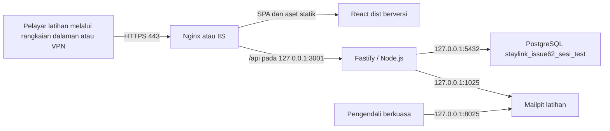

# STAYLink MBSP Demo Release 1.0 · Templat pemasangan

Sediakan salinan ini untuk semakan JTIK. Jalankan pemasangan hanya selepas JTIK meluluskan hos latihan, akaun servis, rangkaian, TLS, log, penyimpanan dan tatacara pemulihan. Gunakan keluaran berasaskan SHA yang telah disemak.

## Sempadan demo



- Hos demo menggunakan `NODE_ENV=development` bersama gerbang wajib `STAYLINK_DEMO_HOST=true` dan `STAYLINK_SYNTHETIC_PORTAL=true`. Fastify berjalan tanpa watch di localhost. Profil ini memerlukan origin HTTPS tepat dan kuki sesi Secure, HttpOnly dan SameSite=Strict.
- Asingkan hos, akaun servis, PostgreSQL dan Mailpit daripada sistem operasi MBSP. Hanya titik masuk HTTPS dibenarkan kepada peserta. Port 3001, 5432, 1025 dan 8025 kekal loopback. Mailpit tiada relay, forwarding atau laluan SMTP keluar.
- Gunakan data dan alamat `@example.test` sahaja. Akaun kit tidak berkongsi kata laluan atau TOTP. Bukti portal adalah metadata simulasi. Pintu simpanan/imbasan sebenar, serahan rasmi, MBSPPay, nombor rasmi dan SSO kekal tertutup.
- CSP frontend membenarkan aset setempat. Semak fallback peta dan input koordinat. Jika JTIK meluluskan peta luar, perlu semak pembekal, DNS, firewall, CSP, privasi dan prestasi sebelum mengubah kedua-dua templat.
- Sebagai titik mula untuk penilaian JTIK, pertimbangkan 2 vCPU, RAM 4 GB dan ruang 20 GB untuk aplikasi, DB latihan dan log. Ukur pada konfigurasi, data dan bilangan pengguna JTIK yang disasarkan. Ujian smoke serentak bukan komitmen kapasiti.

## Penyediaan bersama selepas kelulusan

1. Gunakan Node.js LTS sekurang-kurangnya 22.12, npm, PostgreSQL loopback, Mailpit loopback dan checkout yang telah disemak. Jalankan `npm ci`, `npm run db:generate` dan `npm run build` pada direktori keluaran. Pakej backend menggunakan `tsx` daripada lockfile. Kekalkan kebergantungan pembangunan yang diperlukan untuk runtime ini.
2. Cipta **DB kosong baharu** `staylink_issue62_<sesi>_test` dan peranan latihan keistimewaan minimum. Gunakan kelayakan operasi latihan yang diluluskan. Salin `demo.env.example` ke fail privat di luar Git dan isi origin HTTPS, kedua-dua URL DB yang sama, serta kunci MFA dan identiti rawak berasingan. Gunakan nama DB yang dibenarkan dan kata laluan berpengekodan URL jika perlu. Jangan cetak nilai atau gunakan tetapan persekitaran produksi.
3. Sediakan direktori sementara privat. Linux boleh gunakan direktori milik pengendali berizin 0700. Pada Windows, tetapkan kedua-dua `TEMP` dan `TMP` ke direktori dengan ACL NTFS terhad kepada pengendali, SYSTEM dan kumpulan Administrators tempatan yang diluluskan. Pewarisan ACL pada kit dan fail rahsia mesti memberi akses kepada pemilik sahaja dan prinsipal sistem yang dibenarkan. Simpan fail konfigurasi servis dengan ACL yang hanya membenarkan pengendali dan servis berkenaan.
4. Dari direktori keluaran, jalankan urutan contoh dengan `CONFIG` sebagai laluan fail privat. Hentikan pada kod keluar selain sifar. Di PowerShell, gunakan `$Config` sebagai pemboleh ubah dan semak `$LASTEXITCODE` selepas setiap arahan. Jangan terima `CHECK` sebagai lulus.

```bash
node --env-file="$CONFIG" scripts/demo-host-readiness.mjs --prepare
node --env-file="$CONFIG" scripts/uat-preflight.mjs empty
node --env-file="$CONFIG" --import=tsx scripts/migrate.ts --test
node --env-file="$CONFIG" --import=tsx prisma/seed.ts
node --env-file="$CONFIG" --import=tsx scripts/synthetic-uat-demo.ts
# Tetapkan KIT kepada direktori privat yang dicetak oleh penjana.
node --env-file="$CONFIG" --env-file="$KIT/portal.env" scripts/demo-host-readiness.mjs
node --env-file="$CONFIG" --env-file="$KIT/portal.env" scripts/uat-preflight.mjs kit --kit "$KIT"
```

Jalankan `kit` sebelum log masuk pertama. Kekalkan sejarah sesi terdahulu dan mulakan latihan berulang dengan DB, kit dan ID sesi baharu. Jangan jalankan migrasi atau seed ke DB menggunakan URL selain yang lulus pemeriksaan.

## Linux dengan Nginx

- Semak [templat Nginx](linux/staylink-demo.nginx.conf). Tetapkan alamat bind rangkaian dalaman, nama DNS, laluan sijil dan direktori `apps/web/dist`. Kekalkan proksi `/api`, fallback SPA dan 404 berasingan untuk aset hilang. Semak dengan `nginx -t` sebelum penggunaan. Jangan catat query string, token aktivasi, kuki, payload atau header rahsia.
- Semak [unit systemd](linux/staylink-demo.service). Sesuaikan laluan Node, release dan environment kedua-dua fail. Gunakan pengguna servis tanpa keistimewaan. Simpan fail dengan hak baca minimum. Jalankan pemeriksaan statik di `ExecStartPre`. Semak bahawa proses Fastify hanya mendengar pada loopback.
- Nginx mesti menggantikan `X-Staylink-Demo-Client` dengan IP klien yang dilihatnya untuk had kadar. Jika proksi tambahan atau NAT digunakan, JTIK perlu menyemak sempadan alamat dan kuota. Jangan menerima header alamat daripada klien sebagai bukti identiti.

## Windows Server dengan IIS

- Semak [web.config](windows/web.config). Letakkan dalam direktori React yang telah dibina. Keperluan ialah IIS Static Content, URL Rewrite dan ARR proxy yang diluluskan. Gunakan binding HTTPS pada alamat dalaman dan sijil JTIK. Uji direct navigation ke laluan SPA, status API, MIME aset dan pemeliharaan kuki serta header Origin/CSRF.
- Dalam konfigurasi URL Rewrite aras pelayan, benarkan pelayan menggantikan hanya pemboleh ubah `HTTP_X_STAYLINK_DEMO_CLIENT` bagi tapak ini. ARR mesti memelihara `Origin` dan `X-CSRF-Token`, serta mengembalikan `Set-Cookie` dan status API tanpa ralat tersuai. Kelulusan perubahan global IIS dan pemasangan modul adalah milik JTIK. Gunakan W3C tanpa `cs-uri-query`, cookie, authorization atau header rahsia.
- Semak [pelancar PowerShell](windows/Start-DemoApi.ps1). Pengurus servis yang diluluskan menjalankan pelancar ini dalam foreground dengan `ReleaseRoot`, `ConfigFile` dan `KitEnvFile`. Tiada servis dicipta oleh pelancar. Hadkan kebenaran akaun servis dan sahkan log serta prosedur restart. Templat, ACL dan ARR memerlukan pengesahan pada Windows sebenar.

## Operasi, sandaran dan pemulihan

- Simpan SHA, nama DB latihan, versi polisi, konfigurasi terhad, rekod akses, keputusan dan rujukan CI. Semak `/api/health`, log servis dan kuota storan dengan kebenaran yang diluluskan. Bukti UAT menggunakan alias dan rujukan `EV-*`.
- Sebelum perubahan, buat dump tersulit melalui proses ICT menggunakan `pg_dump --format=custom`. Tumpukan kepada DB latihan yang sepadan dengan nama lulus. Simpan checksum dan rujukan konfigurasi. Uji `pg_restore --exit-on-error --no-owner` ke DB latihan baharu yang kosong. Bandingkan serahan, pautan bukti, invois, rekonsiliasi dan pencetus perlindungan. Elakkan pilihan `--clean` dan jangan timpa DB asal.
- Pulihkan versi aplikasi terdahulu hanya jika serasi dengan skema. Jika perlu pemulihan DB, tukar konfigurasi kepada salinan latihan yang disahkan mengikut kelulusan, kemudian semak origin, kuki, log masuk MFA dan satu aliran pemohon/PIC/PPSK. JTIK menentukan retensi, RPO, RTO dan pelupusan berasingan.
- Periksa Linux dengan [latihan Nginx/TLS](../../scripts/rehearse-demo-host.sh) pada port loopback 5443. Skrip menggunakan kontena sementara dan sijil latihan satu hari, tanpa pemasangan OS atau hos MBSP. Ia memerlukan kit yang belum digunakan dan konfigurasi `APP_ORIGIN=https://localhost:5443`. Bukti IIS, peranti sebenar dan rangkaian MBSP memerlukan pemeriksaan JTIK.

Rujuk [panduan dan penerimaan Demo Release](../../docs/ict-handover/DEMO-RELEASE-1-JTIK-HANDOVER.md) untuk senario, sempadan dan perkara yang perlu diputuskan.
