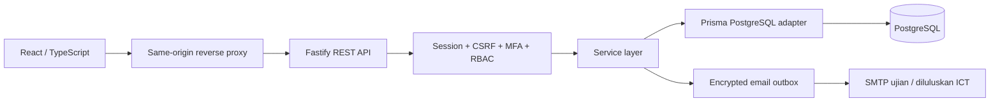

# Seni bina dan pangkalan data

## Aliran aplikasi

`apps/api/src/auth.ts`: pengesahan identiti, sesi dan authorization middleware. `services.ts`: jemputan, dashboard, penugasan serta resolver PIC. `routes.ts`: validasi input dan orchestration; Prisma ialah data access layer. `core.ts`: konfigurasi, kriptografi, audit dan Notification Service. Kebenaran mesti disemak sebelum semua query sensitif; frontend bukan sempadan keselamatan.

`packages/shared` mengandungi validasi dan matriks peranan. Permission sebenar disimpan dalam PostgreSQL dan dibaca semula pada setiap tindakan. Permission frontend hanya menentukan menu. Pelantikan dinilai menggunakan status, masa mula dan tamat, dengan skop daerah pada operasi kawasan. Semua timestamp disimpan melalui Prisma sebagai UTC; UI menukar kepada `Asia/Kuala_Lumpur`.

## Jadual teras

| Kumpulan | Jadual | Fungsi |
|---|---|---|
| Identiti | users | Individu unik melalui e-mel dinormalisasi, jenis akaun, pengesahan dan consent |
| Token | authentication_identities | Token hash, tujuan, luput dan penggunaan sekali sahaja; ruang provider untuk evolusi SSO |
| Sesi | sessions | Hash token, hash CSRF, peranan aktif, status MFA, luput 8 jam |
| MFA | mfa_factors, recovery_codes | Rahsia TOTP AES-GCM, step terakhir untuk antipengulangan; hash kod pemulihan |
| RBAC | roles, permissions, user_role_assignments | Pelbagai peranan, skop jabatan/daerah, rujukan dan pemberi kuasa, tarikh pelantikan |
| Organisasi | departments, districts, areas | Empat jabatan asas; SPU, SPT, SPS; master kawasan |
| Penugasan | area_assignments | Sejarah PIC, sebab, pemberi tugas dan tarikh; unik bagi penugasan tanpa tarikh tamat |
| Syarikat | companies, company_representatives | SSM unik dinormalisasi; banyak wakil bagi banyak syarikat |
| Dokumen | delegation_documents | PDF peribadi dalam BYTEA, fingerprint SHA-256, status dan tempoh sah; ID kekal untuk pautan masa depan |
| Komunikasi | notifications, email_delivery_logs | Notifikasi portal, masa dibaca, outbox disulitkan, status dan percubaan SMTP |
| Templat | template_definitions, template_versions | Semua kategori, versi immutable, DRAFT/ACTIVE/ARCHIVED |
| Konfigurasi | system_configurations, configuration_versions | Nilai JSON dan sejarah perubahan mengikut skop operasi/teknikal |
| Audit | audit_logs | Pelaku, konteks peranan, tindakan, sasaran, keputusan, metadata terpilih |

Hubungan FK utama berada dalam SQL migrasi dan Prisma. Medan identiti pelaku audit dan penugasan tertentu sengaja disimpan sebagai ID teks untuk mengekalkan rekod sejarah; validasi kewujudan berlaku dalam service. Skop jabatan pelantikan disimpan; aliran teknikal berasaskan jabatan belum mempunyai data kes dalam Fasa 1.

## Integriti dan transaksi

- PostgreSQL unique constraint menghalang e-mel, SSM dan nombor versi bertindih.
- Aktivasi token dan penebusan recovery code menggunakan conditional update dalam transaksi.
- `SELECT ... FOR UPDATE` pada kawasan menyusun penugasan semula serentak; index separa menghalang dua PIC semasa.
- Versi templat dikunci per definisi semasa penomboran dan pengaktifan.
- Bootstrap dan migrasi menggunakan advisory locks.
- Audit tiada endpoint edit/delete. Pengukuhan pangkalan data append-only dan akses audit luar host ialah kerja ICT sebelum produksi.

## Keputusan reka bentuk

CSS biasa dengan design tokens terpusat dipilih berbanding Tailwind untuk mengurangkan lapisan konfigurasi. React Hook Form dan TanStack Query mengurus borang/cache. Graf Recharts tidak dipasang kerana tiada metrik operasi sebenar dalam Fasa 1. Fon sistem berlesen platform digunakan; tiada aset fon atau logo rasmi MBSP yang diandaikan tersedia.

Fail PDF disimpan dalam PostgreSQL untuk prototaip dalaman yang boleh dipulihkan bersama backup. Object storage, antivirus/quarantine, lifecycle dan saiz dokumen produksi perlu disemak ICT. Tiada dokumen dilayan sebagai HTML sebaris.

Kontrak `integrations.ts` ialah interface sahaja: AI, bayaran, GIS, SSO, tandatangan dan WhatsApp tidak mempunyai sambungan aktif atau respons simulasi yang dipersembahkan sebagai keputusan sebenar.
