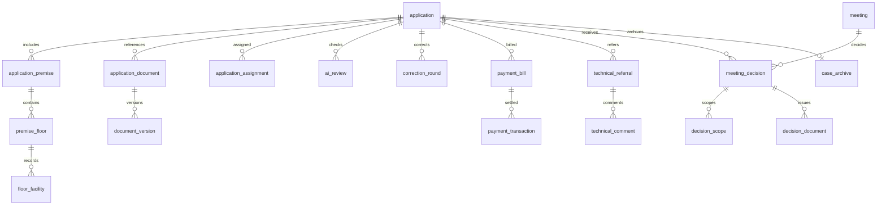

# Pelan skema dan peraturan Fasa 2

Modul berikut belum mempunyai pelaksanaan keputusan atau data permohonan rekaan. Kontrak integrasi disediakan tetapi tidak diaktifkan.

## Model hubungan yang dicadangkan

`application`: UUID dalaman sejak penghantaran pertama; `official_reference` nullable hingga lengkap disahkan PIC, version/status dan tarikh. `company_id`/representative snapshot mengekalkan kapasiti semasa penghantaran.

`application_premise`: lot, alamat, koordinat, kawasan, unit. `premise_floor`: nombor tingkat, bilik, pekerja, keluasan. `floor_facility` merekod kemudahan mengikut unit/aras. Tiada `employer_allocation` dalam skop Jabatan Bangunan; urusan majikan dan kapasiti pekerja di bawah JTK. Sumber tunggal menjana jadual konsolidasi.

`application_document`: pautan kepada dokumen umum atau premis/aras, termasuk `delegation_document_id` Fasa 1 yang masih sah. `document_version`: object key, checksum, tarikh versi dan asal. Geran/hak milik mesti terkini dalam enam bulan. Dokumen dan surat kuasa yang relevan boleh dipautkan semula tanpa kehilangan versi.

`application_assignment`: skop kes/unit, PIC, sebab dan pihak PPSK. Premis berbilang lokasi boleh memerlukan aturan PIC khusus; jika tidak jelas, `PERLU PENENTUAN PPSK`.

`ai_review`: input version IDs, model/version, dapatan, masa, human confirmation. AI Pre-Check membantu PIC dan tidak meluluskan sendiri. `correction_round` mengekalkan UUID yang sama.

## Gerbang proses wajib

1. Penghantaran awal: UUID unik sahaja. **Jangan jana rujukan `MBSP/...` di sini.**
2. PIC mengesahkan lengkap: jana rujukan rasmi unik dalam transaksi, boleh diaudit.
3. Bil RM50 **setiap unit premis**, bukan setiap tingkat. Webhook MBSPPay mesti disahkan secara kriptografi, idempotent dan dipadankan dengan bil/jumlah.
4. Selepas pengesahan bayaran sebenar, rujuk Perancang Bandar dan Kejuruteraan secara automatik dan serentak. Tempoh ulasan tujuh hari kalendar; tiada ulasan bukan persetujuan.
5. Ulasan umum serta mengikut unit/aras. Kedua-dua jabatan hanya melihat data kes yang dirujuk dalam skop kuasa.
6. KP-PPTT menggunakan templat berpusat dan data konsolidasi. PIC boleh menyemak/meminda; boleh disediakan sebelum tujuh hari dengan status ulasan yang tepat.
7. `meeting_decision` menyimpan LULUS, LULUS_BERSYARAT, TOLAK atau TANGGUH. `decision_scope` boleh berbeza setiap unit/aras, bilik dan kapasiti.
8. Satu surat keputusan induk dengan jadual terperinci. Keputusan susulan menggunakan rujukan induk sama, sambil mengekalkan sejarah keputusan.
9. Tandatangan elektronik/digital dan PDF terlindung hanya selepas integrasi dan hierarki pengesahan diluluskan. Penyedia tidak boleh mengesahkan sendiri walaupun bertukar peranan.
10. Penutupan kes induk automatik hanya apabila semua skop diputuskan muktamad dan semua dokumen keputusan dikeluarkan; audit dan arkib digital kekal.

## Urutan pembangunan dicadangkan

Muktamadkan peraturan kawasan dan UAT Fasa 1 → modul permohonan/premis/aras/dokumen → workflow PIC/pembetulan → rujukan rasmi dan MBSPPay → teknikal selari/SLA → KP-PPTT/mesyuarat → keputusan berskop/tandatangan → arkib dan laporan. Setiap langkah memerlukan migrasi, ujian negatif kuasa/skop dan ujian integrasi sebenar apabila akses tersedia.

## Kemajuan pelaksanaan

Fasa 2A akaun pemohon dan Fasa 2B.1 penyediaan draf kini dilaksanakan; lihat PHASE2A.md dan PHASE2B1.md. Model `application_drafts` menyimpan UUID draf dalaman sebelum penghantaran rasmi. Ini bukan model `application`/UUID penghantaran yang dicadangkan di atas. Butiran premis, rujukan dan keputusan/integrasi dalam pelan ini masih belum dibina.

## Maklumat premis agregat

Fasa 2B.2 kini menambah satu rekod premis agregat kepada draf: lokasi/pin, jumlah bangunan, pekerja dan maklumat sijil. Tiada rekod bilik individu, penghantaran rasmi, penentuan sempadan GIS atau keputusan kelulusan. Model terperinci dalam pelan ini belum diaktifkan. Rujuk PHASE2B2.md untuk skop sebenar dan had rangkaian peta.

## Pelaksanaan berperingkat — ringkasan tingkat

Modul `packages/shared/src/floor-summary.ts` menyediakan skema ketat dan pengiraan konsolidasi bilik, katil, jumlah pekerja, keluasan, tandas, bilik mandi, sinki, meja makan, kerusi makan dan pemadam api. Ujian kontrak di `tests/floor-summary.test.ts`. **Ini bukan penyimpanan data tingkat atau penghantaran rasmi**; migrasi pangkalan data, API pemilik draf, UI pemohon dan ujian integrasi masih diperlukan. Jangan paparkan modul sebagai siap sebelum langkah ini dilaksanakan.

## Kemajuan penyimpanan tingkat (17 November 2026)

Model Prisma `PremiseFloor` dan migrasi `202611170001_premise_floors` telah ditambah. API terhad kepada pemohon yang memiliki draf: `GET /api/application-drafts/:id/floors` dan `PUT /api/application-drafts/:id/floors`. PUT memerlukan `version` dan senarai `floors` yang mematuhi skema `packages/shared/src/floor-summary.ts`; penggantian semua baris tingkat berlaku dalam transaksi dengan kawalan versi, serta log audit. GET mengembalikan senarai dan jumlah konsolidasi. Pemohon tidak boleh menulis pada draf bukan miliknya atau draf yang bukan berstatus DRAFT. **Belum diuji terhadap PostgreSQL sebenar; migrasi, Prisma client generation, integrasi dan antaramuka pengguna mesti diuji sebelum dianggap siap.**

## Antaramuka butiran tingkat (17 November 2026)

`apps/web/src/Floors.tsx` menyediakan borang pemohon mengikut tingkat, tambah/buang aras, input bilik, katil, pekerja, keluasan dan enam jenis kemudahan. Jumlah dipaparkan daripada `summarizePremiseFloors` sebelum penyimpanan. Route `/permohonan/draf/:id/tingkat` disambung dalam `apps/web/src/main.tsx` dan pautan langkah dimasukkan dalam `Premises.tsx`. Data dihantar kepada API draf dengan nombor versi. **Ujian TypeScript, migrasi, integrasi, visual UI dan UAT belum dilaksanakan**; jangan gunakan untuk urusan rasmi sehingga lulus pengesahan. Penghantaran rasmi masih dinyahaktifkan.

## Semakan silang jumlah premis dan tingkat

`packages/shared/src/premises-consistency.ts` membandingkan bilangan tingkat, bilik, pekerja dan keluasan lantai dengan agregat premis. API GET/PUT tingkat memulangkan `mismatches`, dan borang tingkat memaparkan amaran serta pautan pembetulan. Ini ialah **amaran pada draf**, bukan penolakan automatik atau pengesahan kapasiti oleh JTK. Ujian unit disediakan dalam `tests/premises-consistency.test.ts`, tetapi belum dilaksanakan dalam CI atau persekitaran setempat.

## Jadual konsolidasi dalam semakan draf

`apps/web/src/FloorReview.tsx` memaparkan baris mengikut tingkat dan jumlah automatik untuk bilik, katil, pekerja, keluasan serta kemudahan (tandas, bilik mandi, sinki, meja/kerusi makan, pemadam api). Komponen dipanggil oleh `PremisesSummary` di `apps/web/src/Premises.tsx`, dengan amaran apabila agregat premis tidak sepadan. `apps/api/src/premise-floors.ts` menjana UUID eksplisit bagi `createMany` kerana migrasi tidak menyediakan default UUID pada pangkalan data. **Belum menjalankan ujian build, migrasi, TypeScript atau UAT; status bukan sedia produksi.**

## Aliran draf dan konsistensi dua hala

Selepas menyimpan premis dengan tindakan CONTINUE, pemohon kini ke `/permohonan/draf/:id/tingkat` sebelum semakan draf. GET dan PUT premis mengembalikan `floorTotals` dan `floorMismatches` berdasarkan rekod tingkat yang sudah disimpan; editor premis menunjukkan amaran jika agregat berbeza. Editor tingkat pula menyediakan muat semula eksplisit apabila API memulangkan konflik versi HTTP 409 (perubahan setempat yang belum disimpan akan hilang). Perubahan ini belum diuji melalui build/CI atau integrasi PostgreSQL; tidak bermaksud penghantaran rasmi sudah diaktifkan.

## Semakan kelengkapan draf (belum mengaktifkan penghantaran)

`packages/shared/src/draft-readiness.ts` menilai kelengkapan maklumat premis, kesahan rekod tingkat dan kesepadanan agregat. API GET/PUT premis memulangkan `readiness` dan halaman semakan draf menunjukkan isu yang perlu diperbetul. `tests/draft-readiness.test.ts` menyediakan kes ujian draf kosong, draf konsisten dan draf bercanggah. Status `readyForNextStage` **bukan** kebenaran menghantar permohonan, bukan pengesahan PIC dan bukan keputusan kapasiti JTK. Tiada penghantaran rasmi, nombor rujukan atau bayaran diaktifkan. Build, CI dan integrasi DB masih perlu disahkan.

## Simpan sebelum semakan draf

Halaman tingkat kini menyediakan tindakan `Simpan draf tingkat` dan `Simpan dan ke Semakan Draf`. Tindakan kedua hanya menavigasi selepas PUT berjaya; apabila gagal atau berlaku konflik versi, pemohon kekal pada editor dan melihat ralat. Query maklumat premis dinyah-sah cache selepas simpan supaya status readiness dikira semula. Amaran ketidakpadanan yang tersimpan disembunyikan sementara pengguna mengubah borang, kemudian dikemas kini daripada respons API. Ujian unit tambahan mengesahkan nama tingkat berulang tidak dianggap lengkap. CI dan ujian integrasi masih perlu disahkan.

## Senarai semak dokumen sokongan awal

`packages/shared/src/supporting-documents.ts` menyenaraikan tujuh kategori persediaan dokumen dengan pemakaian umum, syarikat atau jika berkaitan. `apps/web/src/PreliminaryDocumentChecklist.tsx` memaparkan senarai dalam Semakan Draf dan menyatakan secara jelas bahawa muat naik/pengesahan dokumen belum tersedia. Ujian kategori dan pemakaian ditambah dalam `tests/supporting-documents.test.ts`. Senarai ini **cadangan awal, belum dimuktamadkan sebagai senarai dokumen wajib MBSP**; jangan anggap dokumen telah dimuat naik atau diluluskan. Modul penyimpanan fail, pengesahan pegawai, kawalan akses, deklarasi digital dan penghantaran rasmi masih belum dibina. Ujian automatik belum disahkan lulus.

## Pengesahan keselamatan fail sebelum muat naik sebenar

`apps/api/src/draft-upload-validation.ts` menyediakan validasi ketat Base64, saiz konfigurasi mengikut kategori, tandatangan fail PDF/JPEG/PNG dan padanan MIME. `tests/draft-upload-validation.test.ts` meliputi kategori, MIME palsu, Base64 tidak sah, fail kosong dan had saiz. **Belum ada endpoint muat naik dokumen permohonan**; utiliti ini tidak menyimpan fail atau mengesahkan dokumen. Sebelum mengaktifkan endpoint perlu wujud storan objek persendirian, pengimbasan malware, rekod versi/hash, akses pemilik draf dan PIC, audit, pengekalan/pemadaman fail serta mekanisme streaming yang tidak bergantung pada JSON Base64 besar. Ujian CI belum disahkan lulus.

## Metadata dokumen berversi dan bacaan terhad

`ApplicationDocument` dalam Prisma dan migrasi `202611170002_application_documents` merekod kategori, versi, nama, MIME, saiz, SHA-256, kunci storan persendirian, status imbasan (`PENDING/CLEAN/INFECTED/FAILED`), status pengesahan (`UNVERIFIED/VERIFIED/REJECTED`) serta masa/pegawai berkaitan. `GET /api/application-drafts/:id/documents` memerlukan akaun pemohon, pemilikan draf DRAFT dan kuasa wakil syarikat yang sah; respons memilih metadata yang tidak termasuk `storageKey` dan tidak memberi URL muat turun. Endpoint **baca sahaja**: tiada POST muat naik, tiada storan fail, tiada imbasan malware sebenar, tiada pengesahan pegawai, tiada dokumen dianggap lengkap dan tiada penghantaran rasmi. Migrasi, TypeScript, ujian dan CI masih perlu disahkan sebelum penggunaan.

## Paparan status dokumen draf

Komponen `PreliminaryDocumentChecklist` kini memanggil `GET /api/application-drafts/:id/documents` menggunakan identiti sesi pemohon, memaparkan metadata versi dokumen semasa dan status `scanStatus`/`verificationStatus` apabila ada. Paparan kegagalan API tidak menganggap dokumen lengkap. Respons premis turut memulangkan `capacity` bagi memaparkan item surat kuasa syarikat hanya apabila permohonan dibuat sebagai syarikat. Rekod metadata tidak membuktikan dokumen telah diimbas atau disahkan; tiada muat naik, URL fail, muat turun, deklarasi atau penghantaran diaktifkan. Build, migrasi PostgreSQL dan ujian integrasi belum disahkan.

## Status dokumen selamat dan berversi

`packages/shared/src/document-checklist-status.ts` mengelaskan dokumen mengikut versi aktif tertinggi, dengan aturan gagal-selamat: status `VERIFIED` hanya dipaparkan apabila `scanStatus=CLEAN` dan `verificationStatus=VERIFIED`. Rekod `INFECTED`/`FAILED` tidak boleh disahkan; `PENDING` dan status tidak dikenali dipaparkan sebagai menunggu imbasan. Versi yang `supersededAt` terisi diabaikan. UI Semakan Draf kini memaparkan label status yang mudah difahami. `tests/document-checklist-status.test.ts` meliputi tujuh senario termasuk pemakaian pemohon syarikat. Ini ialah logik paparan metadata, **bukan pengimbasan malware sebenar** dan bukan gerbang kelulusan. Ujian automatik belum disahkan dijalankan.

## Pengukuhan privasi metadata dan kunci storan

`GET /api/application-drafts/:id/documents` kini menetapkan `Cache-Control: private, no-store` dan tidak memulangkan `sha256` atau `storageKey` kepada pemohon. Paparan semakan dokumen memuat semula status apabila komponen dibuka atau tetingkap kembali aktif. `apps/api/src/private-document-keys.ts` menjana kunci objek tidak boleh diramal di bawah skop UUID draf dan kategori yang disahkan; fungsi semakan skop menghalang padanan draf lain dan laluan tidak sah. `tests/private-document-keys.test.ts` meliputi keunikan, skop dan input traversal. **Ini belum penyambungan storan objek**: belum ada bucket, konfigurasi akses, muat naik, pengimbasan malware, pengesahan PIC atau endpoint muat turun. Kunci objek sahaja bukan kawalan autorisasi. CI, build dan ujian masih belum disahkan.

## Kontrak storan kuarantin persendirian

`apps/api/src/private-document-store.ts` mentakrif `PrivateDocumentStore` untuk simpan/baca/padam objek kuarantin tanpa URL awam. `storeQuarantinedDocument` mengesahkan skop kunci UUID draf, saiz, jenis MIME dan menjana SHA-256 sebelum menyerahkan bytes kepada adapter. `DisabledDocumentStore` menolak semua operasi supaya muat naik tidak boleh diaktifkan secara tidak sengaja. `tests/private-document-store.test.ts` menyediakan ujian adapter palsu, kunci silang draf, fail kosong dan penolakan adapter tidak aktif. **Belum ada adapter bucket sebenar atau pengimbasan malware**, dan pengesahan tandatangan kandungan mesti dilakukan oleh lapisan `validateDraftUpload` sebelum storan dipanggil. Tiada endpoint muat naik, tiada perubahan produksi. Ujian dan CI belum disahkan.

## Keselamatan fail kuarantin: MIME dan kontrak pengimbasan

`storeQuarantinedDocument` kini menguatkuasakan MIME dan had saiz maksimum mengikut kategori pelan/gambar/sokongan serta menyemak tandatangan PDF, JPEG atau PNG sebelum adapter dipanggil. `tests/private-document-store.test.ts` menambah ujian fail PDF palsu dan PDF dalam kategori gambar. `apps/api/src/document-malware-scanner.ts` memperkenalkan kontrak `DocumentMalwareScanner`, pengesahan SHA-256 fail kuarantin sebelum imbasan, keputusan eksplisit CLEAN/INFECTED/FAILED dan `DisabledMalwareScanner` yang menolak operasi jika tidak dikonfigurasi. `tests/document-malware-scanner.test.ts` menguji integriti fail, keputusan INFECTED dan kegagalan selamat apabila tiada scanner. **Tiada pengimbas malware sebenar, tiada storan bucket sebenar dan tiada endpoint muat naik**. Keputusan CLEAN daripada adapter ujian bukan pengesahan sebenar MBSP; tiada status pangkalan data diubah oleh kontrak ini. CI belum disahkan.

## Adapter ClamAV (belum diaktifkan)

`apps/api/src/clamav-scanner.ts` menyediakan adapter ClamAV TCP INSTREAM (chunk 64 KiB, respons CLEAN/INFECTED, masa tamat dan ralat fail-closed). `apps/api/src/malware-scanner-config.ts` hanya membina adapter apabila `STAYLINK_CLAMAV_ENABLED=true` dan `STAYLINK_CLAMAV_HOST` sah; port pilihan `STAYLINK_CLAMAV_PORT` (lalai 3310). Tanpa opt-in, `DisabledMalwareScanner` digunakan. Perkhidmatan clamd mesti berada pada rangkaian dalaman yang dikawal firewall; TCP clamd tidak menyediakan autentikasi atau TLS dengan sendirinya. Konfigurasi ini belum dipanggil oleh endpoint pemohon; **tiada imbasan sebenar telah dijalankan**. Ujian unit konfigurasi disediakan, tetapi ujian integrasi clamd, sambungan storan objek dan CI belum disahkan. Jangan aktifkan muat naik sehingga storan persendirian, pengimbasan dan pengesahan pegawai disambungkan secara selamat.

## Pengukuhan protokol ClamAV INSTREAM

Adapter ClamAV tidak lagi menutup bahagian tulis soket sejurus selepas penghantaran penanda chunk sifar; ia menunggu respons daemon sebelum menutup sambungan. `tests/clamav-instream.test.ts` menambah ujian integrasi protokol TCP setempat dengan daemon simulasi untuk respons `stream: OK`, `FOUND` dan `ERROR`. Ujian ini tidak menggantikan ujian terhadap clamd sebenar dan belum disahkan dijalankan dalam CI. Storan objek persendirian dan endpoint muat naik kekal belum disambungkan; tiada pengaktifan produksi.

## Rekod keputusan imbasan ke pangkalan data (servis dalaman)

`apps/api/src/document-scan-worker.ts` menambah `processPendingDocumentScan` yang mengambil metadata dokumen `PENDING`, membaca objek kuarantin, menyemak SHA-256 dan memanggil pengimbas, kemudian menulis `CLEAN`/`INFECTED`/`FAILED` menggunakan `updateMany` bersyarat (id, draftId, storageKey, sha256, PENDING dan belum superseded). Kegagalan storan, integriti, sambungan atau pengimbas ditanda `FAILED`, bukan `CLEAN`. Dokumen sudah diproses atau diganti dilangkau. `tests/document-scan-worker.test.ts` menyediakan ujian kejayaan, kegagalan pengimbas, rekod superseded dan konflik kemas kini. **Servis ini belum dipanggil oleh job runner atau endpoint**, dan storan sebenar belum dikonfigurasi. Pengaktifan muat naik dan semakan pegawai masih ditangguh. Ujian/CI belum disahkan.

## Pemprosesan kelompok imbasan dokumen

`apps/api/src/document-scan-batch.ts` menyediakan `processPendingDocumentScanBatch` untuk job runner dalaman: memilih maksimum 50 rekod `PENDING` yang belum diganti mengikut tarikh muat naik, memproses secara berurutan melalui `processPendingDocumentScan`, dan memulangkan kiraan CLEAN/INFECTED/FAILED/SKIPPED. `tests/document-scan-batch.test.ts` meliputi had kelompok, pengiraan keputusan dan kegagalan pengimbas. **Belum ada scheduler, storan objek sebenar, endpoint muat naik atau pengaktifan produksi.** Pengendalian perlumbaan masih berdasarkan conditional update; proses imbasan berganda mungkin berlaku jika beberapa runner dijalankan serentak, walaupun kemas kini keputusan dilindungi. Perlukan mekanisme claim/lease untuk operasi berskala. Ujian belum disahkan berjalan.

## Lease imbasan dokumen (kawalan pemproses serentak)

Migrasi `202611170003_document_scan_lease` menambah `scanLeaseToken`, `scanLeaseExpiresAt` dan status `SCANNING`. `processPendingDocumentScan` menggunakan tuntutan atomik `updateMany` terhadap dokumen PENDING atau SCANNING yang lease-nya tamat, token rawak dan tempoh 5 minit. Keputusan hanya boleh disimpan oleh pemegang token yang masih sah; token dibersihkan apabila selesai. Pemilihan batch merangkumi lease tamat tempoh. Kod ini belum disambungkan kepada storan objek sebenar, job scheduler atau endpoint muat naik. Migrasi dan ujian belum disahkan dijalankan. Tempoh lease 5 minit mesti dinilai bersama had masa ClamAV dan keperluan operasi sebelum produksi.

## Pengesahan pemilikan scan lease

`tests/document-scan-lease.test.ts` menambah ujian tuntutan lease sebelum imbasan, penolakan apabila lease dimiliki proses lain dan perlindungan apabila penyimpanan keputusan gagal akibat lease tamat. Skema Prisma kini turut mengisytiharkan indeks gabungan `[scanStatus, scanLeaseExpiresAt]` selaras dengan migrasi SQL. Ujian masih perlu dijalankan dalam CI dan terhadap PostgreSQL sebenar; tidak ada pengaktifan muat naik atau deployment.

## Adapter storan kuarantin setempat untuk ujian pembangunan

`apps/api/src/local-quarantine-document-store.ts` menambah `LocalQuarantineDocumentStore` yang melaksanakan kontrak `PrivateDocumentStore` menggunakan direktori setempat, kunci fail berformat UUID terikat draf, penciptaan fail eksklusif (`wx`) dan mod fail 0600. `tests/local-quarantine-document-store.test.ts` meliputi simpan/baca/padam PDF, larangan overwrite dan penolakan path traversal. **Adapter ini hanya untuk pembangunan/ujian**, bukan storan objek produksi: ia tidak menguatkuasakan semua kawalan terhadap symlink, encryption-at-rest, retensi atau pengasingan multi-instance. Gunakan direktori yang dikawal sepenuhnya oleh proses aplikasi dan tidak boleh ditulis oleh pengguna lain. Tiada endpoint muat naik diaktifkan, tiada integrasi storan bucket sebenar, dan ujian belum disahkan lulus.

## Ujian integrasi storan kuarantin dan scan worker

`tests/document-quarantine-integration.test.ts` menggunakan direktori sementara sebenar melalui `LocalQuarantineDocumentStore` bersama mock Prisma dan mock pengimbas. Ujian memeriksa aliran simpan -> baca -> SHA-256 -> imbas -> keputusan CLEAN, pengesanan kandungan yang berubah (FAILED tanpa memanggil pengimbas), dan fail kuarantin hilang (FAILED). Ini **bukan** ujian pangkalan data PostgreSQL sebenar, ClamAV sebenar atau storan objek produksi. Tiada endpoint muat naik diaktifkan dan CI belum disahkan.

## Ujian integrasi TCP ClamAV dan konfigurasi storan

`tests/document-clamav-integration.test.ts` menguji aliran fail PDF setempat -> SHA-256 -> lease -> protokol TCP ClamAV menggunakan daemon simulasi -> rekod keputusan mock Prisma, untuk respons OK, FOUND dan ERROR. Ia tidak menggantikan ujian terhadap daemon ClamAV sebenar atau PostgreSQL sebenar.

`apps/api/src/document-store-config.ts` menambah pemilihan storan **fail-closed**: lalai `STAYLINK_DOCUMENT_STORE=disabled`; hanya `local` dibenarkan dalam pembangunan/ujian dengan `STAYLINK_LOCAL_DOCUMENT_STORE_ENABLED=true` dan `STAYLINK_LOCAL_DOCUMENT_ROOT` ditetapkan. Mod local ditolak apabila `NODE_ENV=production`. Mod `s3`/R2 belum dilaksanakan dan sengaja ditolak. `tests/document-store-config.test.ts` meliputi sekatan tersebut. Factory ini belum disambung kepada endpoint atau scheduler; tiada muat naik atau deployment diaktifkan. Ujian belum disahkan dijalankan.

## Pengukuhan adapter storan setempat terhadap symlink

Adapter pembangunan `LocalQuarantineDocumentStore` kini memeriksa laluan ibu melalui `realpath`, menolak direktori akar yang merupakan symlink, menggunakan `O_NOFOLLOW` ketika membuka fail untuk baca/tulis dan menolak objek symlink semasa pemadaman. `tests/local-quarantine-document-store.test.ts` menambah ujian fail symlink. Kawalan ini mengurangkan risiko capaian luar direktori, tetapi bukan jaminan terhadap semua perlumbaan TOCTOU atau penggantian direktori oleh proses lain. Direktori akar masih mesti dikawal sepenuhnya oleh proses aplikasi; adapter tidak sesuai untuk produksi. Ujian belum disahkan dijalankan.

## Semakan automatik cabang pembangunan

`.github/workflows/staylink-phase1-checks.yml` menjalankan GitHub Actions apabila ada push ke `staylink-mbsp-phase1` atau arahan manual. Job menggunakan Node.js 22, `npm ci`, `npm run db:generate`, `npm run typecheck`, `npm run lint`, dan `npm test`. Storan dokumen dinyahaktifkan dan ClamAV sebenar tidak diaktifkan; ujian TCP menggunakan daemon simulasi. Workflow ini tidak mempunyai akses penulisan repositori, tidak menjalankan migrasi ke DB produksi dan tidak deploy. Status lulus/gagal perlu diperiksa pada tab Actions; penambahan fail workflow sahaja bukan bukti ujian lulus.

## Pengukuhan aliran TCP ClamAV

`ClamAvScanner.scan()` kini menghantar bingkai INSTREAM secara berperingkat dan menunggu acara `drain` apabila `socket.write()` memulangkan `false`, bagi mengelakkan penimbalan keseluruhan dokumen dalam penimbal tulis rangkaian. Pembetulan ujian `document-scan-lease.test.ts` membuang penggunaan `any` eksplisit. Semakan CI pada commit terkini belum dapat disahkan melalui connector (carian yang tersedia terhad kepada run berkaitan pull request); semak tab GitHub Actions untuk status sebenar. Tiada deployment atau migrasi produksi dibuat.

## Pembetulan framing INSTREAM selepas perubahan backpressure

Semakan kod mendapati arahan INSTREAM pernah menggunakan aksara backslash dan angka sifar secara literal (`\\0`) dan bukannya penamat NUL (`\0`) selepas refaktor backpressure. `apps/api/src/clamav-scanner.ts` telah dibetulkan. Ujian regresi `tests/clamav-framing-regression.test.ts` mengesahkan header `zINSTREAM` dengan NUL dan pembahagian fail 150,000 bait kepada bingkai 65,536 + 65,536 + 18,928 bait serta bingkai tamat panjang sifar. Ini ujian daemon simulasi; keputusan CI masih perlu disahkan sebelum menyatakan integrasi berjaya.

## Semakan symlink bagi setiap direktori perantaraan

Adapter storan setempat kini menyemak setiap komponen direktori antara akar kuarantin dan objek menggunakan `lstat`, dan menolak sebarang direktori perantaraan yang merupakan symlink, termasuk symlink yang menunjuk semula ke dalam akar. Ujian `tests/local-quarantine-document-store.test.ts` meliputi kes ini. Ini mengurangkan risiko lencongan laluan, namun masih bukan pertahanan lengkap terhadap perlumbaan TOCTOU apabila direktori boleh diubah serentak oleh proses lain. Penggunaan produksi kekal dilarang; keputusan ujian CI masih belum disahkan.

## Pembersihan kegagalan penulisan dan symlink akar

Adapter setempat kini menggunakan `dirname` dan `relative` untuk memeriksa direktori induk, menggantikan pengiraan rentetan laluan yang lebih rapuh. Jika `writeFile` atau `sync` gagal, adapter cuba menutup fail dan memadam objek separa tanpa menutup ralat asal. Ujian tambahan memastikan direktori akar kuarantin yang berupa symlink ditolak. Adapter kekal untuk pembangunan/ujian sahaja; ia belum mempunyai jaminan atomicity sepenuhnya terhadap proses serentak yang boleh mengubah sistem fail. CI dan integrasi storan objek sebenar belum disahkan.

## Elak penciptaan direktori melalui symlink

`LocalQuarantineDocumentStore.putQuarantined` tidak lagi menggunakan `mkdir(..., { recursive: true })` sebelum pemeriksaan keselamatan. Sebaliknya setiap komponen direktori diperiksa dengan `lstat` selepas cubaan penciptaan satu peringkat, dan operasi dihentikan jika komponen tersebut merupakan symlink atau bukan direktori. Ujian regresi mengesahkan objek tidak diwujudkan pada sasaran symlink. Ini mengurangkan risiko penciptaan fail di luar laluan yang dimaksudkan, namun ancaman TOCTOU daripada proses lain yang boleh menukar direktori serentak masih memerlukan kawalan OS dan storan produksi yang sesuai. Pengisytiharan fixture pengimbas yang tidak digunakan juga dibuang. Ujian CI belum disahkan lulus.

## Konfigurasi storan setempat: allowlist persekitaran

`configuredDocumentStore` kini hanya membenarkan mod `local` apabila `NODE_ENV` tepat `development` atau `test`, `STAYLINK_LOCAL_DOCUMENT_STORE_ENABLED=true`, dan direktori akar ditetapkan. `NODE_ENV` kosong, tidak ditetapkan, `staging`, `preview`, atau `Production` ditolak (*fail closed*). Mod lalai kekal `disabled`; tiada perubahan kepada storan produksi. Ujian regresi ditambah dalam `tests/document-store-config.test.ts`. Keputusan CI masih perlu disahkan.

## Had saiz objek kuarantin setempat

Adapter setempat kini mengenakan had pertahanan 100 MiB bagi `putQuarantined` dan `readQuarantined`, termasuk panggilan terus yang tidak melalui validasi kategori muat naik. Bacaan memeriksa `FileHandle.stat()` terlebih dahulu dan menolak objek kosong, bukan fail biasa atau melebihi had sebelum `readFile()`. Had kategori yang lebih rendah dalam `storeQuarantinedDocument` tetap berkuat kuasa. Ujian menambah kes fail kosong, fail lebih 100 MiB dan fail sparse bersaiz berlebihan. Ini belum bermaksud storan produksi atau laluan upload telah diaktifkan; keputusan CI belum disahkan.
