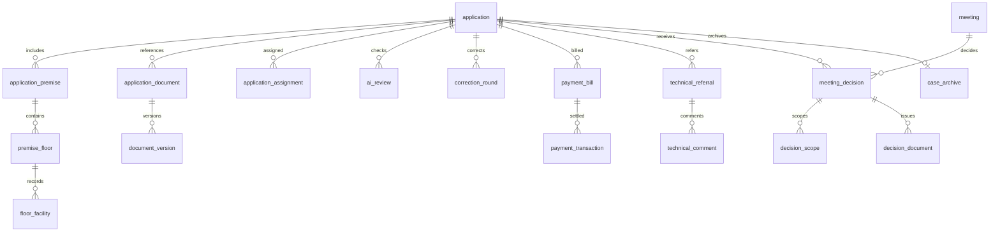

# Pelan skema dan peraturan Fasa 2

Modul berikut belum mempunyai pelaksanaan keputusan atau data permohonan rekaan. Kontrak integrasi disediakan tetapi tidak diaktifkan.

## Model hubungan yang dicadangkan

`application`: UUID dalaman sejak penghantaran pertama; `official_reference` nullable hingga lengkap disahkan PIC, version/status dan tarikh. `company_id`/representative snapshot mengekalkan kapasiti semasa penghantaran.

`application_premise`: lot, alamat, koordinat, kawasan, unit. `premise_floor`: nombor tingkat, bilik, pekerja, keluasan. `floor_facility` merekod kemudahan mengikut unit/aras. Tiada `employer_allocation` dalam skop Jabatan Bangunan; urusan majikan dan kapasiti pekerja di bawah JTK. Sumber tunggal menjana jadual konsolidasi.

`application_document`: pautan kepada dokumen umum atau premis/aras, termasuk `delegation_document_id` Fasa 1 yang masih sah. `document_version`: object key, checksum, tarikh versi dan asal. Geran/hak milik mesti terkini dalam enam bulan. Dokumen dan surat kuasa yang relevan boleh dipautkan semula tanpa kehilangan versi.

`application_assignment`: skop kes/unit, PIC, sebab dan pihak PPSK. Premis berbilang lokasi boleh memerlukan aturan PIC khusus; jika tidak jelas, `PERLU PENENTUAN PPSK`.

`ai_review`: input version IDs, model/version, dapatan, masa, human confirmation. AI Pre-Check membantu PIC dan tidak meluluskan sendiri. `correction_round` mengekalkan UUID yang sama.

## Gerbang proses wajib

1. Penghantaran awal: UUID unik sahaja. **Jangan jana rujukan `MBSP/...` di sini.**
2. PIC mengesahkan lengkap: jana rujukan rasmi unik dalam transaksi, boleh diaudit.
3. Bil RM50 **setiap unit premis**, bukan setiap tingkat. Webhook MBSPPay mesti disahkan secara kriptografi, idempotent dan dipadankan dengan bil/jumlah.
4. Selepas pengesahan bayaran sebenar, rujuk Perancang Bandar dan Kejuruteraan secara automatik dan serentak. Tempoh ulasan tujuh hari kalendar; tiada ulasan bukan persetujuan.
5. Ulasan umum serta mengikut unit/aras. Kedua-dua jabatan hanya melihat data kes yang dirujuk dalam skop kuasa.
6. KP-PPTT menggunakan templat berpusat dan data konsolidasi. PIC boleh menyemak/meminda; boleh disediakan sebelum tujuh hari dengan status ulasan yang tepat.
7. `meeting_decision` menyimpan LULUS, LULUS_BERSYARAT, TOLAK atau TANGGUH. `decision_scope` boleh berbeza setiap unit/aras, bilik dan kapasiti.
8. Satu surat keputusan induk dengan jadual terperinci. Keputusan susulan menggunakan rujukan induk sama, sambil mengekalkan sejarah keputusan.
9. Tandatangan elektronik/digital dan PDF terlindung hanya selepas integrasi dan hierarki pengesahan diluluskan. Penyedia tidak boleh mengesahkan sendiri walaupun bertukar peranan.
10. Penutupan kes induk automatik hanya apabila semua skop diputuskan muktamad dan semua dokumen keputusan dikeluarkan; audit dan arkib digital kekal.

## Urutan pembangunan dicadangkan

Muktamadkan peraturan kawasan dan UAT Fasa 1 → modul permohonan/premis/aras/dokumen → workflow PIC/pembetulan → rujukan rasmi dan MBSPPay → teknikal selari/SLA → KP-PPTT/mesyuarat → keputusan berskop/tandatangan → arkib dan laporan. Setiap langkah memerlukan migrasi, ujian negatif kuasa/skop dan ujian integrasi sebenar apabila akses tersedia.

## Kemajuan pelaksanaan

Fasa 2A akaun pemohon dan Fasa 2B.1 penyediaan draf kini dilaksanakan; lihat PHASE2A.md dan PHASE2B1.md. Model `application_drafts` menyimpan UUID draf dalaman sebelum penghantaran rasmi. Ini bukan model `application`/UUID penghantaran yang dicadangkan di atas. Butiran premis, rujukan dan keputusan/integrasi dalam pelan ini masih belum dibina.

## Maklumat premis agregat

Fasa 2B.2 kini menambah satu rekod premis agregat kepada draf: lokasi/pin, jumlah bangunan, pekerja dan maklumat sijil. Tiada rekod bilik individu, penghantaran rasmi, penentuan sempadan GIS atau keputusan kelulusan. Model terperinci dalam pelan ini belum diaktifkan. Rujuk PHASE2B2.md untuk skop sebenar dan had rangkaian peta.

## Pelaksanaan berperingkat — ringkasan tingkat

Modul `packages/shared/src/floor-summary.ts` menyediakan skema ketat dan pengiraan konsolidasi bilik, katil, jumlah pekerja, keluasan, tandas, bilik mandi, sinki, meja makan, kerusi makan dan pemadam api. Ujian kontrak di `tests/floor-summary.test.ts`. **Ini bukan penyimpanan data tingkat atau penghantaran rasmi**; migrasi pangkalan data, API pemilik draf, UI pemohon dan ujian integrasi masih diperlukan. Jangan paparkan modul sebagai siap sebelum langkah ini dilaksanakan.

## Kemajuan penyimpanan tingkat (17 November 2026)

Model Prisma `PremiseFloor` dan migrasi `202611170001_premise_floors` telah ditambah. API terhad kepada pemohon yang memiliki draf: `GET /api/application-drafts/:id/floors` dan `PUT /api/application-drafts/:id/floors`. PUT memerlukan `version` dan senarai `floors` yang mematuhi skema `packages/shared/src/floor-summary.ts`; penggantian semua baris tingkat berlaku dalam transaksi dengan kawalan versi, serta log audit. GET mengembalikan senarai dan jumlah konsolidasi. Pemohon tidak boleh menulis pada draf bukan miliknya atau draf yang bukan berstatus DRAFT. **Belum diuji terhadap PostgreSQL sebenar; migrasi, Prisma client generation, integrasi dan antaramuka pengguna mesti diuji sebelum dianggap siap.**

## Antaramuka butiran tingkat (17 November 2026)

`apps/web/src/Floors.tsx` menyediakan borang pemohon mengikut tingkat, tambah/buang aras, input bilik, katil, pekerja, keluasan dan enam jenis kemudahan. Jumlah dipaparkan daripada `summarizePremiseFloors` sebelum penyimpanan. Route `/permohonan/draf/:id/tingkat` disambung dalam `apps/web/src/main.tsx` dan pautan langkah dimasukkan dalam `Premises.tsx`. Data dihantar kepada API draf dengan nombor versi. **Ujian TypeScript, migrasi, integrasi, visual UI dan UAT belum dilaksanakan**; jangan gunakan untuk urusan rasmi sehingga lulus pengesahan. Penghantaran rasmi masih dinyahaktifkan.

## Semakan silang jumlah premis dan tingkat

`packages/shared/src/premises-consistency.ts` membandingkan bilangan tingkat, bilik, pekerja dan keluasan lantai dengan agregat premis. API GET/PUT tingkat memulangkan `mismatches`, dan borang tingkat memaparkan amaran serta pautan pembetulan. Ini ialah **amaran pada draf**, bukan penolakan automatik atau pengesahan kapasiti oleh JTK. Ujian unit disediakan dalam `tests/premises-consistency.test.ts`, tetapi belum dilaksanakan dalam CI atau persekitaran setempat.

## Jadual konsolidasi dalam semakan draf

`apps/web/src/FloorReview.tsx` memaparkan baris mengikut tingkat dan jumlah automatik untuk bilik, katil, pekerja, keluasan serta kemudahan (tandas, bilik mandi, sinki, meja/kerusi makan, pemadam api). Komponen dipanggil oleh `PremisesSummary` di `apps/web/src/Premises.tsx`, dengan amaran apabila agregat premis tidak sepadan. `apps/api/src/premise-floors.ts` menjana UUID eksplisit bagi `createMany` kerana migrasi tidak menyediakan default UUID pada pangkalan data. **Belum menjalankan ujian build, migrasi, TypeScript atau UAT; status bukan sedia produksi.**

## Aliran draf dan konsistensi dua hala

Selepas menyimpan premis dengan tindakan CONTINUE, pemohon kini ke `/permohonan/draf/:id/tingkat` sebelum semakan draf. GET dan PUT premis mengembalikan `floorTotals` dan `floorMismatches` berdasarkan rekod tingkat yang sudah disimpan; editor premis menunjukkan amaran jika agregat berbeza. Editor tingkat pula menyediakan muat semula eksplisit apabila API memulangkan konflik versi HTTP 409 (perubahan setempat yang belum disimpan akan hilang). Perubahan ini belum diuji melalui build/CI atau integrasi PostgreSQL; tidak bermaksud penghantaran rasmi sudah diaktifkan.

## Semakan kelengkapan draf (belum mengaktifkan penghantaran)

`packages/shared/src/draft-readiness.ts` menilai kelengkapan maklumat premis, kesahan rekod tingkat dan kesepadanan agregat. API GET/PUT premis memulangkan `readiness` dan halaman semakan draf menunjukkan isu yang perlu diperbetul. `tests/draft-readiness.test.ts` menyediakan kes ujian draf kosong, draf konsisten dan draf bercanggah. Status `readyForNextStage` **bukan** kebenaran menghantar permohonan, bukan pengesahan PIC dan bukan keputusan kapasiti JTK. Tiada penghantaran rasmi, nombor rujukan atau bayaran diaktifkan. Build, CI dan integrasi DB masih perlu disahkan.

## Simpan sebelum semakan draf

Halaman tingkat kini menyediakan tindakan `Simpan draf tingkat` dan `Simpan dan ke Semakan Draf`. Tindakan kedua hanya menavigasi selepas PUT berjaya; apabila gagal atau berlaku konflik versi, pemohon kekal pada editor dan melihat ralat. Query maklumat premis dinyah-sah cache selepas simpan supaya status readiness dikira semula. Amaran ketidakpadanan yang tersimpan disembunyikan sementara pengguna mengubah borang, kemudian dikemas kini daripada respons API. Ujian unit tambahan mengesahkan nama tingkat berulang tidak dianggap lengkap. CI dan ujian integrasi masih perlu disahkan.

## Senarai semak dokumen sokongan awal

`packages/shared/src/supporting-documents.ts` menyenaraikan tujuh kategori persediaan dokumen dengan pemakaian umum, syarikat atau jika berkaitan. `apps/web/src/PreliminaryDocumentChecklist.tsx` memaparkan senarai dalam Semakan Draf dan menyatakan secara jelas bahawa muat naik/pengesahan dokumen belum tersedia. Ujian kategori dan pemakaian ditambah dalam `tests/supporting-documents.test.ts`. Senarai ini **cadangan awal, belum dimuktamadkan sebagai senarai dokumen wajib MBSP**; jangan anggap dokumen telah dimuat naik atau diluluskan. Modul penyimpanan fail, pengesahan pegawai, kawalan akses, deklarasi digital dan penghantaran rasmi masih belum dibina. Ujian automatik belum disahkan lulus.

## Pengesahan keselamatan fail sebelum muat naik sebenar

`apps/api/src/draft-upload-validation.ts` menyediakan validasi ketat Base64, saiz konfigurasi mengikut kategori, tandatangan fail PDF/JPEG/PNG dan padanan MIME. `tests/draft-upload-validation.test.ts` meliputi kategori, MIME palsu, Base64 tidak sah, fail kosong dan had saiz. **Belum ada endpoint muat naik dokumen permohonan**; utiliti ini tidak menyimpan fail atau mengesahkan dokumen. Sebelum mengaktifkan endpoint perlu wujud storan objek persendirian, pengimbasan malware, rekod versi/hash, akses pemilik draf dan PIC, audit, pengekalan/pemadaman fail serta mekanisme streaming yang tidak bergantung pada JSON Base64 besar. Ujian CI belum disahkan lulus.

## Metadata dokumen berversi dan bacaan terhad

`ApplicationDocument` dalam Prisma dan migrasi `202611170002_application_documents` merekod kategori, versi, nama, MIME, saiz, SHA-256, kunci storan persendirian, status imbasan (`PENDING/CLEAN/INFECTED/FAILED`), status pengesahan (`UNVERIFIED/VERIFIED/REJECTED`) serta masa/pegawai berkaitan. `GET /api/application-drafts/:id/documents` memerlukan akaun pemohon, pemilikan draf DRAFT dan kuasa wakil syarikat yang sah; respons memilih metadata yang tidak termasuk `storageKey` dan tidak memberi URL muat turun. Endpoint **baca sahaja**: tiada POST muat naik, tiada storan fail, tiada imbasan malware sebenar, tiada pengesahan pegawai, tiada dokumen dianggap lengkap dan tiada penghantaran rasmi. Migrasi, TypeScript, ujian dan CI masih perlu disahkan sebelum penggunaan.

## Paparan status dokumen draf

Komponen `PreliminaryDocumentChecklist` kini memanggil `GET /api/application-drafts/:id/documents` menggunakan identiti sesi pemohon, memaparkan metadata versi dokumen semasa dan status `scanStatus`/`verificationStatus` apabila ada. Paparan kegagalan API tidak menganggap dokumen lengkap. Respons premis turut memulangkan `capacity` bagi memaparkan item surat kuasa syarikat hanya apabila permohonan dibuat sebagai syarikat. Rekod metadata tidak membuktikan dokumen telah diimbas atau disahkan; tiada muat naik, URL fail, muat turun, deklarasi atau penghantaran diaktifkan. Build, migrasi PostgreSQL dan ujian integrasi belum disahkan.

## Status dokumen selamat dan berversi

`packages/shared/src/document-checklist-status.ts` mengelaskan dokumen mengikut versi aktif tertinggi, dengan aturan gagal-selamat: status `VERIFIED` hanya dipaparkan apabila `scanStatus=CLEAN` dan `verificationStatus=VERIFIED`. Rekod `INFECTED`/`FAILED` tidak boleh disahkan; `PENDING` dan status tidak dikenali dipaparkan sebagai menunggu imbasan. Versi yang `supersededAt` terisi diabaikan. UI Semakan Draf kini memaparkan label status yang mudah difahami. `tests/document-checklist-status.test.ts` meliputi tujuh senario termasuk pemakaian pemohon syarikat. Ini ialah logik paparan metadata, **bukan pengimbasan malware sebenar** dan bukan gerbang kelulusan. Ujian automatik belum disahkan dijalankan.

## Pengukuhan privasi metadata dan kunci storan

`GET /api/application-drafts/:id/documents` kini menetapkan `Cache-Control: private, no-store` dan tidak memulangkan `sha256` atau `storageKey` kepada pemohon. Paparan semakan dokumen memuat semula status apabila komponen dibuka atau tetingkap kembali aktif. `apps/api/src/private-document-keys.ts` menjana kunci objek tidak boleh diramal di bawah skop UUID draf dan kategori yang disahkan; fungsi semakan skop menghalang padanan draf lain dan laluan tidak sah. `tests/private-document-keys.test.ts` meliputi keunikan, skop dan input traversal. **Ini belum penyambungan storan objek**: belum ada bucket, konfigurasi akses, muat naik, pengimbasan malware, pengesahan PIC atau endpoint muat turun. Kunci objek sahaja bukan kawalan autorisasi. CI, build dan ujian masih belum disahkan.

## Kontrak storan kuarantin persendirian

`apps/api/src/private-document-store.ts` mentakrif `PrivateDocumentStore` untuk simpan/baca/padam objek kuarantin tanpa URL awam. `storeQuarantinedDocument` mengesahkan skop kunci UUID draf, saiz, jenis MIME dan menjana SHA-256 sebelum menyerahkan bytes kepada adapter. `DisabledDocumentStore` menolak semua operasi supaya muat naik tidak boleh diaktifkan secara tidak sengaja. `tests/private-document-store.test.ts` menyediakan ujian adapter palsu, kunci silang draf, fail kosong dan penolakan adapter tidak aktif. **Belum ada adapter bucket sebenar atau pengimbasan malware**, dan pengesahan tandatangan kandungan mesti dilakukan oleh lapisan `validateDraftUpload` sebelum storan dipanggil. Tiada endpoint muat naik, tiada perubahan produksi. Ujian dan CI belum disahkan.

## Keselamatan fail kuarantin: MIME dan kontrak pengimbasan

`storeQuarantinedDocument` kini menguatkuasakan MIME dan had saiz maksimum mengikut kategori pelan/gambar/sokongan serta menyemak tandatangan PDF, JPEG atau PNG sebelum adapter dipanggil. `tests/private-document-store.test.ts` menambah ujian fail PDF palsu dan PDF dalam kategori gambar. `apps/api/src/document-malware-scanner.ts` memperkenalkan kontrak `DocumentMalwareScanner`, pengesahan SHA-256 fail kuarantin sebelum imbasan, keputusan eksplisit CLEAN/INFECTED/FAILED dan `DisabledMalwareScanner` yang menolak operasi jika tidak dikonfigurasi. `tests/document-malware-scanner.test.ts` menguji integriti fail, keputusan INFECTED dan kegagalan selamat apabila tiada scanner. **Tiada pengimbas malware sebenar, tiada storan bucket sebenar dan tiada endpoint muat naik**. Keputusan CLEAN daripada adapter ujian bukan pengesahan sebenar MBSP; tiada status pangkalan data diubah oleh kontrak ini. CI belum disahkan.

## Adapter ClamAV (belum diaktifkan)

`apps/api/src/clamav-scanner.ts` menyediakan adapter ClamAV TCP INSTREAM (chunk 64 KiB, respons CLEAN/INFECTED, masa tamat dan ralat fail-closed). `apps/api/src/malware-scanner-config.ts` hanya membina adapter apabila `STAYLINK_CLAMAV_ENABLED=true` dan `STAYLINK_CLAMAV_HOST` sah; port pilihan `STAYLINK_CLAMAV_PORT` (lalai 3310). Tanpa opt-in, `DisabledMalwareScanner` digunakan. Perkhidmatan clamd mesti berada pada rangkaian dalaman yang dikawal firewall; TCP clamd tidak menyediakan autentikasi atau TLS dengan sendirinya. Konfigurasi ini belum dipanggil oleh endpoint pemohon; **tiada imbasan sebenar telah dijalankan**. Ujian unit konfigurasi disediakan, tetapi ujian integrasi clamd, sambungan storan objek dan CI belum disahkan. Jangan aktifkan muat naik sehingga storan persendirian, pengimbasan dan pengesahan pegawai disambungkan secara selamat.

## Pengukuhan protokol ClamAV INSTREAM

Adapter ClamAV tidak lagi menutup bahagian tulis soket sejurus selepas penghantaran penanda chunk sifar; ia menunggu respons daemon sebelum menutup sambungan. `tests/clamav-instream.test.ts` menambah ujian integrasi protokol TCP setempat dengan daemon simulasi untuk respons `stream: OK`, `FOUND` dan `ERROR`. Ujian ini tidak menggantikan ujian terhadap clamd sebenar dan belum disahkan dijalankan dalam CI. Storan objek persendirian dan endpoint muat naik kekal belum disambungkan; tiada pengaktifan produksi.

## Rekod keputusan imbasan ke pangkalan data (servis dalaman)

`apps/api/src/document-scan-worker.ts` menambah `processPendingDocumentScan` yang mengambil metadata dokumen `PENDING`, membaca objek kuarantin, menyemak SHA-256 dan memanggil pengimbas, kemudian menulis `CLEAN`/`INFECTED`/`FAILED` menggunakan `updateMany` bersyarat (id, draftId, storageKey, sha256, PENDING dan belum superseded). Kegagalan storan, integriti, sambungan atau pengimbas ditanda `FAILED`, bukan `CLEAN`. Dokumen sudah diproses atau diganti dilangkau. `tests/document-scan-worker.test.ts` menyediakan ujian kejayaan, kegagalan pengimbas, rekod superseded dan konflik kemas kini. **Servis ini belum dipanggil oleh job runner atau endpoint**, dan storan sebenar belum dikonfigurasi. Pengaktifan muat naik dan semakan pegawai masih ditangguh. Ujian/CI belum disahkan.

## Pemprosesan kelompok imbasan dokumen

`apps/api/src/document-scan-batch.ts` menyediakan `processPendingDocumentScanBatch` untuk job runner dalaman: memilih maksimum 50 rekod `PENDING` yang belum diganti mengikut tarikh muat naik, memproses secara berurutan melalui `processPendingDocumentScan`, dan memulangkan kiraan CLEAN/INFECTED/FAILED/SKIPPED. `tests/document-scan-batch.test.ts` meliputi had kelompok, pengiraan keputusan dan kegagalan pengimbas. **Belum ada scheduler, storan objek sebenar, endpoint muat naik atau pengaktifan produksi.** Pengendalian perlumbaan masih berdasarkan conditional update; proses imbasan berganda mungkin berlaku jika beberapa runner dijalankan serentak, walaupun kemas kini keputusan dilindungi. Perlukan mekanisme claim/lease untuk operasi berskala. Ujian belum disahkan berjalan.

## Lease imbasan dokumen (kawalan pemproses serentak)

Migrasi `202611170003_document_scan_lease` menambah `scanLeaseToken`, `scanLeaseExpiresAt` dan status `SCANNING`. `processPendingDocumentScan` menggunakan tuntutan atomik `updateMany` terhadap dokumen PENDING atau SCANNING yang lease-nya tamat, token rawak dan tempoh 5 minit. Keputusan hanya boleh disimpan oleh pemegang token yang masih sah; token dibersihkan apabila selesai. Pemilihan batch merangkumi lease tamat tempoh. Kod ini belum disambungkan kepada storan objek sebenar, job scheduler atau endpoint muat naik. Migrasi dan ujian belum disahkan dijalankan. Tempoh lease 5 minit mesti dinilai bersama had masa ClamAV dan keperluan operasi sebelum produksi.

## Pengesahan pemilikan scan lease

`tests/document-scan-lease.test.ts` menambah ujian tuntutan lease sebelum imbasan, penolakan apabila lease dimiliki proses lain dan perlindungan apabila penyimpanan keputusan gagal akibat lease tamat. Skema Prisma kini turut mengisytiharkan indeks gabungan `[scanStatus, scanLeaseExpiresAt]` selaras dengan migrasi SQL. Ujian masih perlu dijalankan dalam CI dan terhadap PostgreSQL sebenar; tidak ada pengaktifan muat naik atau deployment.

## Adapter storan kuarantin setempat untuk ujian pembangunan

`apps/api/src/local-quarantine-document-store.ts` menambah `LocalQuarantineDocumentStore` yang melaksanakan kontrak `PrivateDocumentStore` menggunakan direktori setempat, kunci fail berformat UUID terikat draf, penciptaan fail eksklusif (`wx`) dan mod fail 0600. `tests/local-quarantine-document-store.test.ts` meliputi simpan/baca/padam PDF, larangan overwrite dan penolakan path traversal. **Adapter ini hanya untuk pembangunan/ujian**, bukan storan objek produksi: ia tidak menguatkuasakan semua kawalan terhadap symlink, encryption-at-rest, retensi atau pengasingan multi-instance. Gunakan direktori yang dikawal sepenuhnya oleh proses aplikasi dan tidak boleh ditulis oleh pengguna lain. Tiada endpoint muat naik diaktifkan, tiada integrasi storan bucket sebenar, dan ujian belum disahkan lulus.

## Ujian integrasi storan kuarantin dan scan worker

`tests/document-quarantine-integration.test.ts` menggunakan direktori sementara sebenar melalui `LocalQuarantineDocumentStore` bersama mock Prisma dan mock pengimbas. Ujian memeriksa aliran simpan -> baca -> SHA-256 -> imbas -> keputusan CLEAN, pengesanan kandungan yang berubah (FAILED tanpa memanggil pengimbas), dan fail kuarantin hilang (FAILED). Ini **bukan** ujian pangkalan data PostgreSQL sebenar, ClamAV sebenar atau storan objek produksi. Tiada endpoint muat naik diaktifkan dan CI belum disahkan.

## Ujian integrasi TCP ClamAV dan konfigurasi storan

`tests/document-clamav-integration.test.ts` menguji aliran fail PDF setempat -> SHA-256 -> lease -> protokol TCP ClamAV menggunakan daemon simulasi -> rekod keputusan mock Prisma, untuk respons OK, FOUND dan ERROR. Ia tidak menggantikan ujian terhadap daemon ClamAV sebenar atau PostgreSQL sebenar.

`apps/api/src/document-store-config.ts` menambah pemilihan storan **fail-closed**: lalai `STAYLINK_DOCUMENT_STORE=disabled`; hanya `local` dibenarkan dalam pembangunan/ujian dengan `STAYLINK_LOCAL_DOCUMENT_STORE_ENABLED=true` dan `STAYLINK_LOCAL_DOCUMENT_ROOT` ditetapkan. Mod local ditolak apabila `NODE_ENV=production`. Mod `s3`/R2 belum dilaksanakan dan sengaja ditolak. `tests/document-store-config.test.ts` meliputi sekatan tersebut. Factory ini belum disambung kepada endpoint atau scheduler; tiada muat naik atau deployment diaktifkan. Ujian belum disahkan dijalankan.

## Pengukuhan adapter storan setempat terhadap symlink

Adapter pembangunan `LocalQuarantineDocumentStore` kini memeriksa laluan ibu melalui `realpath`, menolak direktori akar yang merupakan symlink, menggunakan `O_NOFOLLOW` ketika membuka fail untuk baca/tulis dan menolak objek symlink semasa pemadaman. `tests/local-quarantine-document-store.test.ts` menambah ujian fail symlink. Kawalan ini mengurangkan risiko capaian luar direktori, tetapi bukan jaminan terhadap semua perlumbaan TOCTOU atau penggantian direktori oleh proses lain. Direktori akar masih mesti dikawal sepenuhnya oleh proses aplikasi; adapter tidak sesuai untuk produksi. Ujian belum disahkan dijalankan.

## Semakan automatik cabang pembangunan

`.github/workflows/staylink-phase1-checks.yml` menjalankan GitHub Actions apabila ada push ke `staylink-mbsp-phase1` atau arahan manual. Job menggunakan Node.js 22, `npm ci`, `npm run db:generate`, `npm run typecheck`, `npm run lint`, dan `npm test`. Storan dokumen dinyahaktifkan dan ClamAV sebenar tidak diaktifkan; ujian TCP menggunakan daemon simulasi. Workflow ini tidak mempunyai akses penulisan repositori, tidak menjalankan migrasi ke DB produksi dan tidak deploy. Status lulus/gagal perlu diperiksa pada tab Actions; penambahan fail workflow sahaja bukan bukti ujian lulus.

## Pengukuhan aliran TCP ClamAV

`ClamAvScanner.scan()` kini menghantar bingkai INSTREAM secara berperingkat dan menunggu acara `drain` apabila `socket.write()` memulangkan `false`, bagi mengelakkan penimbalan keseluruhan dokumen dalam penimbal tulis rangkaian. Pembetulan ujian `document-scan-lease.test.ts` membuang penggunaan `any` eksplisit. Semakan CI pada commit terkini belum dapat disahkan melalui connector (carian yang tersedia terhad kepada run berkaitan pull request); semak tab GitHub Actions untuk status sebenar. Tiada deployment atau migrasi produksi dibuat.

## Pembetulan framing INSTREAM selepas perubahan backpressure

Semakan kod mendapati arahan INSTREAM pernah menggunakan aksara backslash dan angka sifar secara literal (`\\0`) dan bukannya penamat NUL (`\0`) selepas refaktor backpressure. `apps/api/src/clamav-scanner.ts` telah dibetulkan. Ujian regresi `tests/clamav-framing-regression.test.ts` mengesahkan header `zINSTREAM` dengan NUL dan pembahagian fail 150,000 bait kepada bingkai 65,536 + 65,536 + 18,928 bait serta bingkai tamat panjang sifar. Ini ujian daemon simulasi; keputusan CI masih perlu disahkan sebelum menyatakan integrasi berjaya.

## Semakan symlink bagi setiap direktori perantaraan

Adapter storan setempat kini menyemak setiap komponen direktori antara akar kuarantin dan objek menggunakan `lstat`, dan menolak sebarang direktori perantaraan yang merupakan symlink, termasuk symlink yang menunjuk semula ke dalam akar. Ujian `tests/local-quarantine-document-store.test.ts` meliputi kes ini. Ini mengurangkan risiko lencongan laluan, namun masih bukan pertahanan lengkap terhadap perlumbaan TOCTOU apabila direktori boleh diubah serentak oleh proses lain. Penggunaan produksi kekal dilarang; keputusan ujian CI masih belum disahkan.

## Pembersihan kegagalan penulisan dan symlink akar

Adapter setempat kini menggunakan `dirname` dan `relative` untuk memeriksa direktori induk, menggantikan pengiraan rentetan laluan yang lebih rapuh. Jika `writeFile` atau `sync` gagal, adapter cuba menutup fail dan memadam objek separa tanpa menutup ralat asal. Ujian tambahan memastikan direktori akar kuarantin yang berupa symlink ditolak. Adapter kekal untuk pembangunan/ujian sahaja; ia belum mempunyai jaminan atomicity sepenuhnya terhadap proses serentak yang boleh mengubah sistem fail. CI dan integrasi storan objek sebenar belum disahkan.

## Elak penciptaan direktori melalui symlink

`LocalQuarantineDocumentStore.putQuarantined` tidak lagi menggunakan `mkdir(..., { recursive: true })` sebelum pemeriksaan keselamatan. Sebaliknya setiap komponen direktori diperiksa dengan `lstat` selepas cubaan penciptaan satu peringkat, dan operasi dihentikan jika komponen tersebut merupakan symlink atau bukan direktori. Ujian regresi mengesahkan objek tidak diwujudkan pada sasaran symlink. Ini mengurangkan risiko penciptaan fail di luar laluan yang dimaksudkan, namun ancaman TOCTOU daripada proses lain yang boleh menukar direktori serentak masih memerlukan kawalan OS dan storan produksi yang sesuai. Pengisytiharan fixture pengimbas yang tidak digunakan juga dibuang. Ujian CI belum disahkan lulus.

## Konfigurasi storan setempat: allowlist persekitaran

`configuredDocumentStore` kini hanya membenarkan mod `local` apabila `NODE_ENV` tepat `development` atau `test`, `STAYLINK_LOCAL_DOCUMENT_STORE_ENABLED=true`, dan direktori akar ditetapkan. `NODE_ENV` kosong, tidak ditetapkan, `staging`, `preview`, atau `Production` ditolak (*fail closed*). Mod lalai kekal `disabled`; tiada perubahan kepada storan produksi. Ujian regresi ditambah dalam `tests/document-store-config.test.ts`. Keputusan CI masih perlu disahkan.

## Had saiz objek kuarantin setempat

Adapter setempat kini mengenakan had pertahanan 100 MiB bagi `putQuarantined` dan `readQuarantined`, termasuk panggilan terus yang tidak melalui validasi kategori muat naik. Bacaan memeriksa `FileHandle.stat()` terlebih dahulu dan menolak objek kosong, bukan fail biasa atau melebihi had sebelum `readFile()`. Had kategori yang lebih rendah dalam `storeQuarantinedDocument` tetap berkuat kuasa. Ujian menambah kes fail kosong, fail lebih 100 MiB dan fail sparse bersaiz berlebihan. Ini belum bermaksud storan produksi atau laluan upload telah diaktifkan; keputusan CI belum disahkan.

## Ujian regresi protokol ClamAV dan symlink

Ujian `clamav-framing-regression.test.ts` kini merekod panjang bingkai INSTREAM dan baki bait dalam callback TCP, kemudian membuat assertion selepas `scan()` berjaya. Header tidak sah dibalas sebagai ralat protokol, bukannya `socket.destroy(new Error(...))` yang boleh mencetuskan ralat socket tidak dikendalikan. Ujian storan kuarantin kini turut memastikan penolakan direktori symlink tidak menghasilkan fail pada lokasi sasaran yang dialihkan. Perubahan telah dikomitkan tetapi CI masih belum disahkan.

## Had masa keseluruhan imbasan ClamAV

`ClamAvScanner` kini mengenakan had masa dinding (*wall-clock deadline*) di samping had masa sambungan tidak aktif. Pemasa dibersihkan apabila imbasan selesai atau gagal. Ini memastikan respons pelayan yang dihantar sedikit demi sedikit tidak boleh mengekalkan sambungan tanpa had. Ujian regresi `tests/clamav-instream.test.ts` meniru daemon yang menghantar bait secara berkala dan mengesahkan imbasan ditolak apabila tempoh keseluruhan tamat. Kod telah dikomitkan, tetapi keputusan CI belum disahkan.

## Pelaksana kelompok imbasan dokumen (opt-in)

Ditambah `apps/api/src/document-scan-runner.ts`, arahan sekali jalan `scripts/scan-documents.ts` dan skrip npm `npm run documents:scan`. Proses hanya dibenarkan apabila `STAYLINK_DOCUMENT_SCAN_BATCH_ENABLED=true`, storan dokumen diaktifkan secara jelas dan `STAYLINK_CLAMAV_ENABLED=true`. Had `STAYLINK_DOCUMENT_SCAN_BATCH_LIMIT` lalai 10, maksimum 50. Proses menggunakan lease atomik dan semakan integriti SHA-256 yang telah dibangunkan, kemudian mengeluarkan ringkasan jumlah dokumen diperiksa, bersih, dijangkiti, gagal dan dilangkau. Ujian ditambah untuk opt-in, konfigurasi, had dan kelompok kosong. Pada masa ini adapter `local` masih terhad kepada `development`/`test`; **jangan jalankan arahan ini pada produksi**. Tiada scheduler automatik, storan produksi atau laluan muat naik diaktifkan. Keputusan CI belum disahkan.

## Pra-pengesahan konfigurasi CLI imbasan dokumen

`scripts/scan-documents.ts` kini memuatkan konfigurasi persekitaran dan menjalankan `validateDocumentScanConfiguration` **sebelum** import dinamik `core.ts` yang mewujudkan Prisma Client. Pra-pengesahan memerlukan pengaktifan kelompok, storan sah, ClamAV sah, dan had integer 1–50. Runner berkongsi validator yang sama. Ujian khusus menolak konfigurasi produksi/staging, ClamAV tidak lengkap, had tidak sah dan arahan tanpa opt-in. Storan `local` kekal untuk pembangunan/ujian sahaja; tiada storan produksi atau pemprosesan automatik diaktifkan. Keputusan CI masih belum disahkan.

## Kod keluar arahan imbasan dokumen

Arahan `npm run documents:scan` kini memulangkan kod keluar `1` apabila sekurang-kurangnya satu dokumen mempunyai keputusan `FAILED`, membolehkan pengendali tugas menjadualkan amaran tanpa menganggap dokumen `INFECTED` sebagai ralat pengimbas. Kod keluar `0` untuk kelompok tanpa kegagalan teknikal, termasuk dokumen dijangkiti yang kekal disekat melalui status rekod. Ringkasan diperiksa supaya semua kaunter integer bukan negatif dan jumlah keputusan sepadan dengan `examined`. Ujian regresi ditambah. Fungsi ini tidak menjadualkan tugas atau menghantar notifikasi secara automatik; keputusan CI belum disahkan.

## Pengasingan kegagalan setiap dokumen dalam kelompok

`processPendingDocumentScanBatch` kini menangkap ralat tidak dijangka daripada `processPendingDocumentScan` bagi setiap dokumen secara berasingan, menambah kaunter `failed` dan meneruskan dokumen seterusnya. Ini meliputi contohnya kegagalan pertanyaan pangkalan data bagi satu dokumen; kegagalan pertanyaan senarai kelompok awal masih menyebabkan tugas gagal secara keseluruhan. Kod keluar CLI yang ditambah sebelum ini akan bernilai bukan sifar apabila kaunter `failed` melebihi sifar. Ujian regresi meniru kegagalan carian dokumen pertama dan memastikan dokumen kedua tetap diimbas. Keputusan CI belum disahkan.

## Semakan awal kesediaan dokumen untuk penghantaran

Ditambah `apps/api/src/document-submission-readiness.ts` untuk mengira kategori dokumen wajib yang masih menghalang penghantaran berdasarkan senarai semak sedia ada. Kategori `ALL` wajib untuk semua pemohon; `COMPANY` hanya bagi syarikat; `IF_AVAILABLE` tidak menghalang penghantaran. Fail semasa mesti berstatus imbasan `CLEAN` dan tidak ditolak; pengesahan pegawai `VERIFIED` tidak diwajibkan pada tahap penghantaran awal. Modul memulangkan `ready`, `blockingCategories` dan `pendingScanCategories`. Ujian meliputi individu, syarikat, dokumen pilihan, imbasan tertangguh, malware, penolakan dan versi dokumen yang diganti. **Belum dihubungkan kepada endpoint penghantaran sebenar**; semakan kebenaran, akuan dan transaksi pelayan tetap diperlukan sebelum pengaktifan. Keputusan CI belum disahkan.

## Integriti versi dokumen sebelum penghantaran

Semakan awal `documentSubmissionReadiness` kini menolak kategori wajib jika terdapat versi aktif yang tidak sah (bukan integer selamat positif) atau dua rekod aktif dengan nombor versi sama. Ini mengelakkan pilihan rekod secara tidak tentu apabila rekod bercanggah, termasuk keadaan satu rekod bersih dan satu dijangkiti. Versi terdahulu yang telah diganti (`supersededAt`) tidak dikira. Ujian regresi disediakan. Semakan ini masih modul dalaman dan belum disambungkan kepada endpoint penghantaran; keputusan CI belum disahkan.

## Kawalan status pengesahan dokumen tidak dikenali

`documentChecklistRows` kini menganggap hanya `UNVERIFIED` sebagai menunggu semakan pegawai selepas imbasan `CLEAN`; `VERIFIED` kekal disahkan dan `REJECTED` kekal ditolak. Nilai pengesahan lain yang tidak dikenali dipetakan kepada `UNSAFE` (sekatan konservatif) dan tidak boleh melepasi `documentSubmissionReadiness`. Ujian regresi meliputi nilai status yang tidak dikenali. Ini ialah kawalan dalaman; endpoint penghantaran sebenar masih belum diaktifkan dan keputusan CI belum disahkan.

## Snapshot kesediaan dokumen daripada pangkalan data

Ditambah `loadDocumentSubmissionReadiness` dalam `apps/api/src/document-submission-readiness-db.ts`. Fungsi ini mengesahkan format UUID draf, mengambil metadata dokumen bagi `draftId` yang tepat daripada Prisma (`category`, `version`, `fileName`, status imbasan/pengesahan dan `supersededAt`), lalu menggunakan penilaian kesediaan sedia ada. Ujian meliputi penapisan draf, metadata terpilih, ID tidak sah dan syarat syarikat. Fungsi ini **bukan endpoint** dan **tidak mengesahkan pemilikan atau kuasa pengguna**; pemanggil mesti mengesahkan akses kepada draf. Semakan muktamad mesti dilakukan dalam transaksi penghantaran untuk mengelakkan perubahan dokumen di antara semakan dan penghantaran. Tiada pengaktifan penghantaran sebenar; CI belum disahkan.

## Dokumen pilihan yang telah dimuat naik tetap tertakluk kepada imbasan

`documentSubmissionReadiness` kini hanya mengecualikan kategori `IF_AVAILABLE` apabila tiada dokumen aktif. Jika dokumen pilihan telah dimuat naik, status `PENDING`/`SCANNING`, `INFECTED`/`FAILED`, atau `REJECTED` akan menghalang kesediaan penghantaran sama seperti dokumen wajib. Dokumen pilihan yang `CLEAN` dan `UNVERIFIED` atau `VERIFIED` dibenarkan oleh semakan awal. Ujian regresi meliputi dokumen pilihan tiada, menunggu imbasan, dijangkiti dan bersih. Modul masih belum dihubungkan kepada endpoint penghantaran sebenar; keputusan CI belum disahkan.

## Endpoint baca sahaja untuk kesediaan penghantaran draf

`GET /api/application-drafts/:id/submission-readiness` kini tersedia sebagai **semakan baca sahaja**. Ia memerlukan sesi pemohon `applications.draft` dan profil pengenalan lengkap melalui `applicant(req)`, mencari draf berstatus `DRAFT` yang `initiatedByUserId` sepadan, dan mengesahkan kuasa syarikat semasa melalui `companyAuthority(tx,...)` dalam transaksi yang sama. Kapasiti tidak dikenali ditolak. Fungsi `loadDocumentSubmissionReadiness` kini menerima `Prisma.TransactionClient` untuk pembacaan dalam transaksi. Respons: `{draftId,ready,blockingCategories,pendingScanCategories,submissionEnabled:false}`. Endpoint `POST /submit` **kekal ditutup**; respons ini bukan kelulusan dan tidak menggantikan pemeriksaan transaksi akhir sebelum penghantaran. Ujian integrasi endpoint dan keputusan CI belum disahkan; perlu diuji sebelum sebarang pelepasan.

## Pengesahan konsistensi konteks pemohon bagi endpoint readiness

Ditambah `validDraftApplicantContext` untuk menyekat draf yang mempunyai kapasiti, `companyId`, `officialApplicantUserId` dan `initiatedByUserId` tidak sepadan. Draf individu mesti mempunyai `companyId=null` dan `officialApplicantUserId=initiatedByUserId`. Draf syarikat mesti mempunyai `companyId` bukan kosong dan `officialApplicantUserId=null`; kelayakan wakil semasa masih disemak oleh `companyAuthority`. Endpoint `GET /api/application-drafts/:id/submission-readiness` mengesahkan konsistensi ini sebelum mengambil metadata dokumen. Ujian unit meliputi konteks sah dan bercanggah. Endpoint penghantaran rasmi masih ditutup. Keputusan CI dan ujian integrasi endpoint belum disahkan.

## Pengukuhan identiti draf dan cache respons readiness

`validDraftApplicantContext` kini memerlukan UUID sah bagi `initiatedByUserId` dan `companyId` bagi permohonan syarikat; keserasian konteks individu/syarikat kekal diperiksa. Ujian regresi merangkumi ID rosak, kosong dan ruang putih. Endpoint `GET /api/application-drafts/:id/submission-readiness` kini menghantar `Cache-Control: private, no-store, max-age=0` serta `Pragma: no-cache` bagi mengurangkan penyimpanan respons khusus pemohon dalam cache yang mematuhi arahan. Ini bukan pengganti kawalan akses, perlindungan pelayan atau penyulitan. Penghantaran rasmi masih ditutup; CI dan ujian integrasi endpoint belum disahkan.

## Kategori dokumen aktif di luar senarai pemohon

`documentSubmissionReadiness` kini mengesan dokumen aktif dengan kategori yang tidak terdapat dalam `preliminaryDocumentChecklist(capacity)`. Ini termasuk kategori tidak dikenali dan dokumen `company_authority` pada draf individu. Jika dikesan, `ready=false` dan `unexpectedActiveDocuments=true`; butiran fail atau kategori luar jangka tidak didedahkan dalam penanda ini. Rekod `supersededAt` tidak dikira. Respons readiness kini mempunyai medan boolean tambahan `unexpectedActiveDocuments` dan ujian kontrak dikemas kini. Sebelum paparan pengguna dibina, medan baharu perlu dikendalikan sebagai isu integriti rekod yang memerlukan pembetulan. Endpoint penghantaran rasmi masih ditutup; CI dan ujian integrasi belum disahkan.

## Integriti satu versi aktif bagi setiap kategori dokumen

Semakan `documentSubmissionReadiness` kini menghalang penghantaran apabila terdapat **lebih daripada satu versi aktif** dalam kategori yang sama, walaupun nombor versi berbeza dan versi terkini bersih. Ini mengelakkan pemilihan versi tertinggi menutup status `INFECTED` pada versi lama yang belum `supersededAt`. Jika versi lama sudah ditandakan superseded dan hanya satu versi aktif yang `CLEAN`, semakan boleh lulus tertakluk kepada syarat lain. Ujian regresi baharu meliputi kedua-dua keadaan. Tiada perubahan kepada endpoint penghantaran rasmi; CI belum disahkan.

## Panduan Bahasa Melayu untuk pemohon berdasarkan readiness

`GET /api/application-drafts/:id/submission-readiness` kini turut mengembalikan `guidance` dengan `headline`, `message`, `issues[]` (kategori, label dokumen dan mesej tindakan) serta `integrityWarning`. Panduan dihasilkan daripada `documentReadinessGuidance` menggunakan senarai semak sedia ada dan status keselamatan; mesej imbasan tertangguh dibezakan daripada isu dokumen lain. Isu kategori tidak dijangka hanya memaparkan amaran umum tanpa butiran fail. Panduan ini untuk persembahan sahaja, **bukan keputusan kelulusan atau autorisasi penghantaran**. `submissionEnabled:false` kekal dan endpoint penghantaran sebenar masih ditutup. Ujian unit panduan telah ditambah, tetapi CI dan ujian integrasi belum disahkan.

## Panduan readiness tidak boleh bercanggah dengan amaran integriti

`documentReadinessGuidance` kini menggunakan kedua-dua `ready` dan `unexpectedActiveDocuments` sebelum memaparkan tajuk dan mesej kejayaan. Walaupun data tidak konsisten menyatakan `ready=true`, amaran integriti memaksa panduan tindakan dan bukannya mesej lengkap. Ujian regresi bagi keadaan bercanggah ditambah. Ini hanya perlindungan persembahan; penghantaran rasmi masih ditutup. CI dan ujian integrasi belum disahkan.

## Paparan semakan awal dokumen dalam draf pemohon

Komponen `apps/web/src/DraftDocumentReadiness.tsx` kini menggunakan TanStack Query untuk membaca `GET /api/application-drafts/:id/submission-readiness` bagi draf tersimpan, memaparkan tajuk/mesej Bahasa Melayu, senarai dokumen yang menghalang, amaran integriti, status muat turun dan butang `Semak semula status dokumen`. Komponen dipasang pada bahagian sisi `apps/web/src/ApplicationDraft.tsx` apabila `draft.id` wujud. Ia tidak mengaktifkan muat naik atau penghantaran; butang hantar rasmi kekal disabled. Ralat API dipaparkan secara umum tanpa mendedahkan butiran dalaman. Semakan awal tidak boleh dianggap kelulusan MBSP. Pengujian UI/browser dan CI belum disahkan.

## Penyegerakan status dokumen selepas simpan draf

Cache TanStack Query bagi `DraftDocumentReadiness` kini menggunakan kunci `["draft-document-readiness", userId, draftId]` untuk memisahkan hasil antara identiti pemohon. Selepas draf disimpan, cache draf semasa diselaraskan dengan respons API dan query readiness draf tersebut dinyah-sah supaya data terkini dibaca semula. Jika pengguna mengubah kapasiti individu/syarikat atau syarikat yang diwakili tanpa menyimpan, panel readiness disembunyikan dan mesej supaya menyimpan dahulu dipaparkan. Langkah ini mengurangkan risiko status senarai semak lama dipersembahkan seolah-olah milik kapasiti baharu. Tiada penghantaran rasmi diaktifkan. Ujian CI, integrasi dan pelayar masih belum disahkan.

## Kitar hayat cache status dokumen pemohon

Panel `DraftDocumentReadiness` kini menetapkan `refetchOnMount: "always"`, `refetchOnWindowFocus: "always"` dan `gcTime: 0` supaya status diperoleh semula apabila panel dibuka atau tetingkap kembali aktif, dan cache tidak disimpan selepas tiada pengguna query. Ini melengkapkan pengasingan query key mengikut userId dan draftId. Jika API mengembalikan HTTP 401, pautan log masuk semula dipaparkan dengan laluan kembali kepada draf yang sedang dibuka. **Cache frontend bukan kawalan akses**; autorisasi pemilikan draf dan wakil syarikat kekal wajib pada API. Perubahan ini belum disahkan melalui ujian browser, CI atau integrasi pangkalan data.

## Pengasingan cache dokumen pada halaman Semakan Draf

`PreliminaryDocumentChecklist` kini menggunakan kunci cache `["application-documents", userId, draftId, capacity]`, `gcTime:0`, dan refetch apabila tetingkap kembali aktif. Jika bacaan API gagal, senarai metadata terdahulu tidak dipaparkan sebagai status terkini. `PremisesSummary` menerima `userId` daripada konteks pemohon yang telah disahkan dan menyerahkannya kepada senarai semak. Kawalan ini tidak menggantikan autorisasi pemilikan draf pada API. Tiada muat naik atau penghantaran rasmi diaktifkan. Build, ujian pelayar dan CI belum disahkan.

## Penyatuan senarai dokumen dan readiness pada Semakan Draf

Halaman `PremisesSummary` kini memaparkan `PreliminaryDocumentChecklist` dan `DraftDocumentReadiness` bersama-sama: jadual rekod dokumen dan mesej tindakan daripada gerbang semakan awal API. Jadual hanya dirender selepas GET metadata berjaya, bukan ketika loading atau ralat. Pemohon boleh memuat semula senarai secara eksplisit. Kedua-dua komponen masih **baca sahaja**; muat naik, penghantaran rasmi, rujukan MBSP dan kelulusan tidak diaktifkan. Ujian CI, integrasi dan browser belum disahkan.

## Kontrak persediaan fail mengikut kategori dokumen

`apps/api/src/draft-document-upload-policy.ts` kini menjana senarai `uploadPolicy` daripada kategori senarai semak yang terpakai kepada kapasiti INDIVIDUAL/COMPANY serta had MIME dan MiB pusat dalam `upload-policy.ts`. Respons baca sahaja `GET /api/application-drafts/:id/documents` mengandungi `uploadPolicy` (kategori, label, MIME dibenarkan, had lalai dan had maksimum keras). Ini bertujuan memberi maklumat persediaan fail sebelum modul muat naik diaktifkan; had lalai bukan semestinya had konfigurasi pentadbir semasa. Ujian unit merangkumi pelan PDF, foto JPEG/PNG dan pemakaian surat kuasa syarikat. **Tiada endpoint POST muat naik diaktifkan**, `uploadEnabled:false` dan `submissionEnabled:false` kekal. Polisi metadata ini bukan autorisasi atau pengesahan keselamatan fail; storan persendirian, streaming, pengimbasan malware, audit, versi dan ujian integrasi masih diperlukan. CI belum disahkan.

## Paparan panduan format dan saiz fail kepada pemohon

`PreliminaryDocumentChecklist` kini membaca `uploadPolicy` daripada respons metadata dokumen dan memaparkan lajur `Format & saiz fail (panduan)` mengikut kategori. Jenis MIME diterjemahkan kepada PDF/JPEG/PNG dan had saiz lalai dipaparkan dalam MiB. Jika polisi kategori tiada, paparan menyatakan panduan belum tersedia dan tidak membuat andaian. Nota menjelaskan bahawa had lalai boleh berbeza daripada konfigurasi pentadbir semasa. Tiada input fail, POST muat naik, penghantaran rasmi atau kebenaran baharu diperkenalkan. Ujian TypeScript, CI dan pelayar belum disahkan.

## Pengesahan konteks pemohon untuk metadata dokumen

`GET /api/application-drafts/:id/documents` kini mengesahkan konsistensi konteks pemohon tersimpan menggunakan `validDraftApplicantContext` sebelum memulangkan metadata fail atau panduan `uploadPolicy`. Draf INDIVIDUAL mesti dipaut kepada pemohon rasmi yang sama dengan pemilik draf tanpa `companyId`; draf COMPANY mesti mempunyai UUID syarikat yang sah dan tiada `officialApplicantUserId`. Autorisasi pemilik draf serta wakil syarikat yang sah kekal diperlukan. Respons turut menetapkan `Cache-Control: private, no-store, max-age=0` dan `Pragma: no-cache`. Penghantaran rasmi dan muat naik fail kekal dinyahaktifkan. Perubahan belum disahkan melalui CI, ujian integrasi PostgreSQL atau ujian pelayar.

## Pengendalian ralat semakan metadata dokumen pada portal

`PreliminaryDocumentChecklist` kini menyediakan pautan `Log masuk semula` apabila GET dokumen memulangkan HTTP 401; pautan mengekalkan laluan kembali ke `/permohonan/draf/:id/semakan`. HTTP 409 (konteks pemohon tidak konsisten) dipaparkan sebagai arahan menyemak semula maklumat draf tanpa mendedahkan maklumat dalaman. Jadual metadata kekal tersembunyi semasa ralat. Tiada pengaktifan muat naik atau penghantaran rasmi. CI, ujian pelayar dan integrasi belum disahkan.

## Pembetulan CI daripada anotasi GitHub Actions (17 Nov 2026)

Run #119 menunjukkan kegagalan TypeScript (exit code 2). Pembetulan pada branch pembangunan: `tests/document-scan-lease.test.ts` menambah penukaran melalui `unknown` untuk pemeriksaan argumen mock; `apps/api/src/routes.ts` menyerahkan `Uint8Array` kepada medan Prisma Bytes; `apps/api/src/core.ts` menggunakan `ReturnType<typeof nodemailer.createTransport>` bagi transporter; `apps/api/src/clamav-scanner.ts` menyalin potongan data imbasan ke `Buffer` yang konsisten dengan jenis Node. Amaran GitHub Actions tentang Node.js 20 dan `ubuntu-latest` adalah berasingan daripada ralat TypeScript. **Keputusan run CI selepas pembetulan belum disahkan**; jangan anggap job telah lulus sehingga log baharu diperiksa.

## Penstabilan persekitaran GitHub Actions (17 Nov 2026)

Workflow `staylink-phase1-checks.yml` menggunakan `ubuntu-24.04` (bukan `ubuntu-latest`) dan tindakan `actions/checkout@v5` serta `actions/setup-node@v5` untuk menangani amaran runtime Node.js 20 dan perubahan imej Ubuntu. Versi Node.js aplikasi yang diuji kekal 22. Ini perubahan pada persekitaran CI sahaja, **bukan bukti TypeScript, lint dan ujian telah lulus**. Semak keputusan run selepas commit sebelum menganggap isu CI selesai. Tiada deployment atau merge ke main.

## Perlindungan paparan draf pemohon (17 Nov 2026)

Endpoint `GET /api/application-drafts` dan `GET /api/application-drafts/:id` kini menetapkan `Cache-Control: private, no-store, max-age=0` serta `Pragma: no-cache` kerana respons mengandungi snapshot maklumat pemohon. Endpoint buka semula draf turut mengesahkan `capacity` yang disokong dan konsistensi `officialApplicantUserId`, `initiatedByUserId`, serta `companyId` sebelum memulangkan draf; semakan autoriti wakil syarikat dikekalkan. Semakan ini tidak menggantikan autentikasi atau autorisasi sedia ada. CI/typecheck/lint/test selepas perubahan belum disahkan lulus; muat naik dokumen dan penghantaran rasmi masih dinyahaktifkan.

## Kawalan integriti semasa mengemas kini draf

Endpoint `PATCH /api/application-drafts/:id` kini mengesahkan nilai kapasiti pemohon dan konsistensi identiti tersimpan (`officialApplicantUserId`, `initiatedByUserId`, `companyId`) sebelum mengambil snapshot baharu atau menjalankan `updateMany`. Rekod tidak konsisten menerima HTTP 409 dan tidak ditulis semula. Autorisasi wakil syarikat asal, semakan versi optimistik dan audit simpanan kekal. CI, typecheck, lint dan ujian integrasi selepas commit belum disahkan; penghantaran rasmi dan muat naik masih tidak diaktifkan.

## Pengasingan ujian CI dan pembetulan laporan 17 Nov 2026

Ujian `document-submission-readiness-db.test.ts` kini menjangkakan medan `unexpectedActiveDocuments: false` pada respons selamat. `tests/api.test.ts` tidak lagi memanggil `app.close()` apabila `beforeAll` gagal sebelum aplikasi diwujudkan; pengesahan `TEST_DATABASE_URL` yang mesti berakhir dengan `_test` dikekalkan. Workflow push kini menjalankan `npx vitest run --exclude tests/api.test.ts` selepas typecheck/lint, dan nama job menerangkan bahawa ia hanya menjalankan ujian tanpa pangkalan data. **Ujian integrasi API sebenar belum dijalankan oleh CI ini**: ia memerlukan PostgreSQL ujian khusus, migrasi dan Mailpit; ini kerja susulan wajib sebelum release. Jangan tafsir status hijau job ini sebagai bukti ujian integrasi atau kesiapsiagaan produksi. Keputusan run baharu masih belum disahkan.

## Penyatuan workflow GitHub Actions

Disahkan terdapat dua workflow yang bertindih: `.github/workflows/staylink-phase1.yml` (legacy, menjalankan `npm test` tanpa `TEST_DATABASE_URL` khusus) dan `.github/workflows/staylink-phase1-checks.yml` (pemeriksaan tanpa pangkalan data). Workflow legacy telah dipadam **hanya daripada branch `staylink-mbsp-phase1`**. Workflow tunggal yang dikekalkan menjalankan npm ci, penjanaan Prisma, typecheck, lint, ujian tanpa pangkalan data, dan web production build pada push; workflow_dispatch juga tersedia. Ujian integrasi API masih memerlukan workflow PostgreSQL ujian berasingan dan belum disahkan lulus. Run terdahulu mungkin kekal merah dalam sejarah GitHub; status CI baharu belum disahkan.

## Ujian integrasi API berasingan (17 Nov 2026)

Workflow baharu `.github/workflows/staylink-api-integration.yml` menggunakan `workflow_dispatch` sahaja (manual), PostgreSQL 16 dengan pangkalan data sementara `staylink_ci_test` dan Mailpit, serta menjalankan migrasi ujian dan `tests/api.test.ts`. Ia tidak menggunakan pangkalan data produksi. Skrip `scripts/migrate.ts --test` kini mengesahkan URL PostgreSQL dan nama pangkalan data berakhir dengan `_test` sebelum sambungan. Kredensial dalam workflow ialah nilai ujian sementara sahaja, bukan kredensial produksi. Workflow biasa kekal untuk typecheck/lint/ujian tanpa pangkalan data/build web. **Workflow integrasi ini belum dilaksanakan atau disahkan lulus**; sebelum pengeluaran produksi, semak hasil run dan betulkan sebarang isu konfigurasi atau ujian. Tidak ada merge atau deployment.

## Pra-pemeriksaan perkhidmatan ujian integrasi

Workflow manual `staylink-api-integration.yml` kini melakukan pra-pemeriksaan selepas memasang dependencies: sambungan PostgreSQL menggunakan `TEST_DATABASE_URL`, pengesahan nama pangkalan data `staylink_ci_test`, serta kesediaan API Mailpit dengan cubaan semula terhad sebelum menjalankan migrasi. Kegagalan persediaan perkhidmatan akan menghentikan job dengan mesej jelas dan mengelakkan ujian API dijalankan pada persekitaran yang tidak lengkap. Workflow masih manual; keputusan pelaksanaan sebenar belum disahkan. Tiada perubahan pada produksi atau branch main.

## Pengukuhan pengasingan ujian API

Sebelum `seed()` dijalankan dalam `tests/api.test.ts`, ujian integrasi kini mewajibkan kedua-dua `DATABASE_URL` dan `TEST_DATABASE_URL`, memastikan protokol PostgreSQL, nama pangkalan data berakhir dengan `_test`, serta kedua-dua URL adalah sepadan sepenuhnya. Ini menutup keadaan berisiko apabila `TEST_DATABASE_URL` selamat tetapi Prisma sebenarnya menggunakan `DATABASE_URL` berbeza. Perubahan hanya pada pengawal ujian; tidak mengaktifkan penghantaran permohonan atau muat naik. Keputusan CI dan ujian integrasi selepas commit masih belum disahkan.

## Semakan sambungan sebenar Prisma dan Mailpit dalam CI

Workflow integrasi manual kini memeriksa kesediaan Mailpit melalui `/api/v1/messages`, endpoint yang juga digunakan oleh ujian e-mel, menggantikan `/api/v1/info`. Sebelum `seed()` dalam `tests/api.test.ts`, ujian menjalankan `SELECT current_database()` melalui Prisma dan mengesahkan nama sebenar sambungan sepadan dengan nama pangkalan data dalam `TEST_DATABASE_URL`, selepas pengesahan kedua-dua URL adalah sama dan berakhir dengan `_test`. Ini ialah kawalan tambahan untuk mengelakkan ujian mengubah pangkalan data yang tidak dijangka. Ujian sebenar dan keputusan CI selepas perubahan masih belum disahkan; tiada pengaktifan upload atau penghantaran rasmi.

## Ketahanan ujian e-mel integrasi Mailpit

Pembantu `emailToken()` dalam `tests/api.test.ts` kini menunggu secara terhad (15 cubaan pada sela 200 ms, maksimum kira-kira 3 saat selain masa respons HTTP) apabila rekod penghantaran SMTP bertanda `SENT` tetapi mesej belum kelihatan dalam indeks Mailpit. Respons senarai dan butiran mesej disemak; token yang hilang atau e-mel yang tidak ditemui akan menghasilkan ralat ujian yang jelas. Ini hanya mengurangkan kegagalan ujian akibat kelewatan pengindeksan; ia tidak mengubah penghantaran e-mel produksi. Ujian integrasi manual dan CI belum disahkan lulus.

## Ringkasan rekod dokumen wajib untuk pemohon

Komponen `PreliminaryDocumentChecklist` kini memaparkan bilangan kategori dokumen wajib yang mempunyai rekod aktif berbanding jumlah kategori wajib mengikut konteks individu/syarikat, serta menyenaraikan kategori yang belum mempunyai rekod aktif. Rekod aktif ditentukan oleh pembantu senarai semak bersama (`documentChecklistRows`) yang tidak mengira versi superseded. Ringkasan ini bukan ukuran dokumen diluluskan atau kelayakan penghantaran; pengesahan imbasan dan pegawai tetap berasingan. Muat naik dan penghantaran rasmi kekal dinyahaktifkan. Perubahan telah dikomit ke branch pembangunan tetapi keputusan CI belum disahkan.

## Penyelarasan dasar kategori dokumen sokongan

Fungsi `uploadKindForSupportingDocument` kini menjadi satu-satunya pemetaan kategori dokumen sokongan kepada dasar muat naik `plan`, `photo` atau `supporting`. Ia digunakan bersama oleh metadata panduan muat naik dan `storeQuarantinedDocument`, bagi mengurangkan risiko had saiz/MIME berbeza antara lapisan. Ujian unit menyemak ketujuh-tujuh kategori dan kelengkapan senarai bagi pemohon syarikat. Perubahan tidak mengaktifkan laluan muat naik, storan produksi atau penghantaran permohonan. Keputusan CI selepas commit masih belum disahkan.

## Pengesahan struktur fail dokumen bersama

`document-file-signatures.ts` kini menyediakan pemeriksaan struktur asas MIME PDF, JPEG dan PNG yang digunakan oleh validator pra-muat-naik serta storan kuarantin. PNG memerlukan tandatangan, panjang IHDR 13 bait, sekurang-kurangnya 33 bait dan lebar/tinggi bukan sifar. Ujian tambahan menolak PNG yang terpotong dan dimensi sifar. Ini hanya pengesahan awal; ia tidak mengesahkan CRC, kandungan PDF/imej sepenuhnya atau keselamatan malware. Storan dan laluan muat naik produksi masih tidak diaktifkan; keputusan CI belum disahkan.

## Pengekodan Base64 kanonik untuk fail draf

`validateDraftUpload()` kini memerlukan hasil pengekodan semula `Buffer` kepada Base64 sepadan tepat dengan input asal selepas semakan saiz dan sintaks. Ini menolak pengekodan yang mempunyai bit pelapik bukan sifar walaupun decoder Node.js masih boleh menghasilkan bait yang sama. Ujian unit menambah kes input tidak kanonik. Kawalan ini tidak menggantikan pengimbasan malware atau pengesahan format penuh, dan tidak mengaktifkan endpoint muat naik. Keputusan CI masih belum disahkan.

## Ujian keselamatan storan kuarantin bagi foto

`tests/private-document-store.test.ts` kini menguji penulisan JPEG dengan penanda struktur asas yang diterima dan memastikan fail JPEG tanpa penanda akhir, PNG terpotong, serta PNG berdimensi sifar ditolak sebelum `putQuarantined()` dipanggil. Fixture ini menguji pengawal struktur sahaja, bukan kebolehnyahkodan imej sebenar atau keputusan antivirus. Laluan muat naik dan storan produksi kekal tidak diaktifkan; keputusan CI masih belum disahkan.

## Semakan integriti ketika membaca storan kuarantin

Pembantu dalaman `readVerifiedQuarantinedDocument()` kini memerlukan kunci storan yang sepadan dengan ID draf, metadata SHA-256 64 digit heksadesimal dan saiz bait positif. Selepas membaca daripada adapter kuarantin, ia mengesahkan panjang dan SHA-256 menggunakan perbandingan masa tetap sebelum memulangkan `Buffer` kepada kod dalaman yang memanggilnya. Ujian unit meliputi kandungan sah, hash/saiz tidak sepadan, metadata tidak sah dan kunci silang draf. Pembantu ini **bukan endpoint HTTP** dan tidak menjalankan semakan identiti pemohon; pemanggil mesti terlebih dahulu mengesahkan kebenaran akses. Imbasan malware, storan produksi, muat naik dan penghantaran rasmi masih belum diaktifkan. Keputusan CI belum disahkan.

## Integrasi semakan integriti dengan pekerja imbasan malware

`scanQuarantinedDocument()` kini menggunakan `readVerifiedQuarantinedDocument()` dan mewajibkan kedua-dua `expectedSha256` dan `expectedByteSize` sebelum memanggil pengimbas. `processPendingDocumentScan()` membaca `byteSize` daripada rekod `ApplicationDocument` dan menghantarnya bersama hash. Ujian unit menegaskan perbezaan saiz menghalang panggilan `scanner.scan`, walaupun hash sepadan. Perubahan ini tidak membuka akses HTTP kepada fail atau mengaktifkan storan produksi. Keputusan CI belum disahkan.

## Pengukuhan pekerja imbasan dan ujian regresi

Ujian `document-scan-worker.test.ts` dikemas kini dengan medan `byteSize` yang diwajibkan selepas integrasi semakan integriti; ujian regresi mengesahkan saiz rekod yang tidak sepadan menghasilkan `FAILED` tanpa memanggil pengimbas. Pekerja imbasan turut menyertakan `byteSize` dalam syarat perbandingan atomik semasa memperoleh lease dan menyimpan keputusan, supaya perubahan metadata di antara dua peringkat tidak dianggap sebagai kejayaan. Ujian unit memeriksa syarat tersebut. Keputusan CI belum disahkan; tiada endpoint muat naik atau deploy diaktifkan.

## Kawalan tambahan bacaan kuarantin dan ujian lease pengimbas

`readVerifiedQuarantinedDocument()` kini menolak metadata saiz melebihi 100 MiB (had siling terbesar bagi kategori dokumen) sebelum adapter storan dibaca. Ujian regresi memastikan bacaan storan tidak berlaku untuk metadata tidak sah. Ujian `document-scan-worker.test.ts` turut meliputi perebutan lease antara pekerja, kehilangan lease sebelum keputusan disimpan, dan keputusan pengimbas dengan nama enjin kosong. Ujian ini ditambah dalam kod tetapi keputusan CI belum disahkan; ia tidak mengaktifkan storan atau muat naik produksi.

## Had bacaan kuarantin mengikut kategori dokumen

Semakan `readVerifiedQuarantinedDocument()` tidak lagi menggunakan had umum 100 MiB untuk semua kategori. Ia mengekstrak kategori daripada kunci storan yang telah disahkan milik draf, memadankannya kepada polisi muat naik pusat, lalu menolak `expectedByteSize` melebihi siling kategori sebelum mengakses storan. Ujian regresi meliputi foto melebihi 20 MiB dan dokumen sokongan melebihi 50 MiB. Had ini ialah kawalan keselamatan, bukan kelulusan fail; pengimbasan malware dan kawalan akses masih diperlukan. CI belum disahkan.

## Pengesahan MIME ketika imbasan dokumen kuarantin

`readVerifiedQuarantinedDocument()` menerima `expectedMimeType` pilihan untuk menyemak MIME terhadap kategori dokumen dan mengesahkan tandatangan struktur kandungan sebelum memulangkan bait. Pekerja imbasan kini membaca `mimeType` daripada `ApplicationDocument`, memasukkannya ke kontrak imbasan dan ke syarat perbandingan atomik semasa claim lease serta menyimpan keputusan. Ujian pekerja mengesahkan ketidakpadanan MIME menghasilkan `FAILED` tanpa memanggil pengimbas. Pengesahan tandatangan ialah semakan struktur awal sahaja, bukan parser fail atau pengganti antivirus. Keputusan CI belum disahkan dan tiada fungsi muat naik produksi diaktifkan.

## Pengukuhan sempadan adapter storan

Bacaan kuarantin kini mengesahkan nilai pulangan adapter ialah `Buffer` dan panjang bait sepadan dengan metadata serta siling kategori sebelum melakukan pengiraan SHA-256. Ujian regresi meliputi adapter memulangkan jenis data salah dan panjang bait berbeza. Ujian kontrak pengimbas turut mengesahkan MIME PDF yang sepadan diterima serta MIME PNG yang tidak sepadan ditolak sebelum pengimbas dipanggil. Ini bukan pengesahan penuh format fail dan tidak mengaktifkan muat naik atau storan produksi. Keputusan CI belum disahkan.

## Pengukuhan semakan struktur PNG

Pengesahan tandatangan fail PNG kini turut menyemak gabungan `bitDepth`/`colorType` yang dibenarkan oleh format PNG, kaedah pemampatan dan penapisan bernilai sifar, serta kaedah interlace 0 atau 1. Ujian muat naik menolak lima variasi pengepala IHDR tidak sah. Ini kekal semakan struktur awal sahaja: CRC, chunk seterusnya dan kebolehnyahkodan imej penuh belum disahkan; pengimbasan malware tetap diperlukan. Keputusan CI belum disahkan.

## Had dimensi PNG mengikut spesifikasi

Semakan struktur `IHDR` PNG kini menolak lebar atau tinggi melebihi `2^31 - 1`, selain menolak dimensi sifar dan kombinasi jenis warna/kedalaman bit tidak sah. Ujian regresi memeriksa kedua-dua medan lebar dan tinggi dengan nilai `0x80000000`. Pemeriksaan ini tidak mengesahkan CRC, semua chunk PNG atau keselamatan imej secara menyeluruh. Keputusan CI belum disahkan; storan produksi dan muat naik pemohon kekal tidak diaktifkan.

## Semakan sintaks pengepala PDF

Pengesahan tandatangan `application/pdf` kini memerlukan pengepala versi berbentuk `%PDF-X.Y` (X dan Y digit ASCII), bukan sekadar awalan `%PDF-`. Ujian regresi menolak nombor versi bukan digit, pemisah tidak sah dan pengepala terpotong. Ini hanya semakan struktur awal; ia tidak mengesahkan keseluruhan fail PDF, tidak menggantikan parser atau pengimbas malware dan tidak mengaktifkan muat naik produksi. Keputusan CI belum disahkan.

## Penyelarasan keselamatan muat naik surat kuasa wakil

Laluan keserasian `validateDelegationPdf` kini menguatkuasakan had pentadbir integer 1–20 MiB, menolak dokumen kosong dan Base64 tidak kanonik, serta menggunakan pengesahan tandatangan PDF bersama (termasuk sintaks versi `%PDF-X.Y`). Semakan panjang pengekodan dilakukan sebelum decode untuk mengehadkan penggunaan memori. Ujian regresi ditambah untuk Base64 tidak kanonik, pengepala PDF tidak sah, dokumen kosong dan had konfigurasi tidak sah. Pemeriksaan ini tidak menggantikan pengimbasan malware, storan persendirian atau pengesahan menyeluruh PDF. Keputusan CI belum disahkan.

## Ujian regresi keputusan imbasan dan pemilikan lease

Ujian pekerja imbasan ditambah bagi memastikan status `INFECTED` disimpan tanpa dipromosikan kepada `CLEAN`, metadata MIME disertakan ketika tuntutan lease, dan keputusan imbasan daripada pekerja yang kehilangan lease tidak dilaporkan sebagai keputusan muktamad (`SKIPPED`). Ini menguji perlindungan sedia ada, bukan pengaktifan pengimbas malware produksi. Keputusan CI belum dapat disahkan.

## Pengesahan metadata keputusan pengimbas

Kontrak `scanQuarantinedDocument` kini menolak nilai `engine` yang bukan rentetan atau hanya ruang kosong walaupun pengimbas memulangkan `status: CLEAN`. Ujian regresi meliputi `null`, nombor, objek dan teks kosong serta memastikan status `FAILED` yang sah kekal `FAILED`. Perubahan ini mengukuhkan penolakan gagal-selamat; ia tidak mengaktifkan pengimbas produksi. Keputusan CI belum disahkan.

## Pengoptimuman pengiraan SHA-256 pengimbasan

`scanQuarantinedDocument` kini menggunakan semula SHA-256 metadata yang telah disahkan secara pemadanan masa tetap oleh `readVerifiedQuarantinedDocument`, dan mengembalikannya dalam bentuk heksadesimal huruf kecil. Ini mengelakkan pengiraan SHA-256 kali kedua pada dokumen besar tanpa memintas pengesahan saiz, kandungan dan MIME yang tersedia. Ujian regresi ditambah bagi SHA-256 metadata huruf besar. CI belum disahkan; pengimbas dan storan produksi masih belum diaktifkan.

## Pengasingan metadata respons pengimbas

`scanQuarantinedDocument` kini memulangkan hanya medan yang dibenarkan (`status`, `engine`, `sha256`), dan menormalisasikan ruang pada nama enjin. Medan tidak dijangka daripada adapter pengimbas, seperti token dalaman atau data diagnostik, tidak lagi disalin ke hasil fungsi. Ujian regresi memeriksa hasil tepat dan memastikan metadata tambahan tidak terdedah. Ini bukan pengaktifan pengimbas produksi. Keputusan CI belum disahkan.

## Pengesahan jenis kandungan sebelum storan kuarantin

`storeQuarantinedDocument` kini memeriksa `Buffer.isBuffer` sebelum membaca saiz, mengira SHA-256 atau memanggil adapter storan. Input bukan Buffer, termasuk teks, `Uint8Array` dan `null`, ditolak secara gagal-selamat. Ujian regresi memastikan `putQuarantined` tidak dipanggil untuk input tersebut. Perubahan ini tidak mengaktifkan storan produksi; keputusan CI masih belum disahkan.

## Salinan defensif kandungan sebelum tulis kuarantin

`storeQuarantinedDocument` kini membuat salinan `Buffer` milik pemanggil selepas pengesahan tandatangan dan sebelum mengira SHA-256 serta memanggil `putQuarantined`. Salinan ini mengurangkan risiko metadata hash tidak sepadan apabila pemanggil mengubah `Buffer` asal semasa operasi storan tak segerak. Ujian regresi memutasi `Buffer` asal dalam adapter dan mengesahkan kandungan kuarantin masih sepadan dengan hash dan MIME yang direkod. Adapter produksi masih perlu menjamin integriti tulis, akses persendirian, enkripsi, dan imbasan malware. Keputusan CI belum disahkan.

## Konsistensi metadata saiz selepas operasi tulis tak segerak

`storeQuarantinedDocument` kini merekod `byteSize` daripada `content.length` pada salinan defensif yang sama digunakan untuk pengiraan SHA-256 dan `putQuarantined`, bukannya membaca semula `input.content.length` selepas `await`. Ujian regresi menggantikan `input.content` semasa adapter menulis dan memastikan metadata yang dipulangkan masih mengesahkan kandungan kuarantin sebenar. Storan produksi belum diaktifkan dan keputusan CI belum disahkan.

## Identiti dokumen kekal semasa operasi storan tak segerak

`storeQuarantinedDocument` kini menyimpan `storageKey` dan `mimeType` yang telah disahkan dalam pemboleh ubah setempat sebelum `await putQuarantined`. Metadata pulangan menggunakan nilai yang sama dengan nilai dihantar ke adapter, walaupun objek `input` diubah oleh pemanggil semasa operasi storan. Ujian regresi menukar kunci dan MIME pemanggil di dalam adapter dan mengesahkan metadata pulangan kekal sepadan dengan objek disimpan. Ujian CI belum disahkan dan storan produksi belum diaktifkan.

## Pengesahan tandatangan pada salinan dokumen kuarantin

`storeQuarantinedDocument` kini menyalin `Buffer` pemanggil dahulu, kemudian memeriksa tandatangan fail pada salinan yang sama sebelum SHA-256 dan operasi `putQuarantined`. Ini mengelakkan pemeriksaan format dilakukan pada `Buffer` asal yang berbeza daripada kandungan disimpan. Ujian regresi memastikan fail PDF dengan tandatangan tidak sah ditolak tanpa memanggil adapter storan. Pemeriksaan tandatangan bukan pengganti pengimbasan malware; storan produksi masih belum diaktifkan dan keputusan CI belum disahkan.
