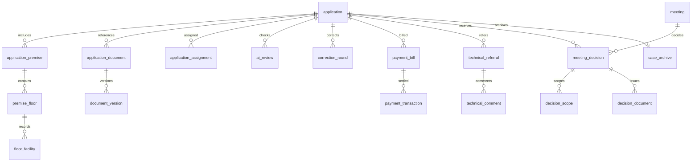

# Pelan skema dan peraturan Fasa 2

Modul berikut belum mempunyai pelaksanaan keputusan atau data permohonan rekaan. Kontrak integrasi disediakan tetapi tidak diaktifkan.

## Model hubungan yang dicadangkan

`application`: UUID dalaman sejak penghantaran pertama; `official_reference` nullable hingga lengkap disahkan PIC, version/status dan tarikh. `company_id`/representative snapshot mengekalkan kapasiti semasa penghantaran.

`application_premise`: lot, alamat, koordinat, kawasan, unit. `premise_floor`: nombor tingkat, bilik, pekerja, keluasan. `floor_facility` merekod kemudahan mengikut unit/aras. Tiada `employer_allocation` dalam skop Jabatan Bangunan; urusan majikan dan kapasiti pekerja di bawah JTK. Sumber tunggal menjana jadual konsolidasi.

`application_document`: pautan kepada dokumen umum atau premis/aras, termasuk `delegation_document_id` Fasa 1 yang masih sah. `document_version`: object key, checksum, tarikh versi dan asal. Geran/hak milik mesti terkini dalam enam bulan. Dokumen dan surat kuasa yang relevan boleh dipautkan semula tanpa kehilangan versi.

`application_assignment`: skop kes/unit, PIC, sebab dan pihak PPSK. Premis berbilang lokasi boleh memerlukan aturan PIC khusus; jika tidak jelas, `PERLU PENENTUAN PPSK`.

`ai_review`: input version IDs, model/version, dapatan, masa, human confirmation. AI Pre-Check membantu PIC dan tidak meluluskan sendiri. `correction_round` mengekalkan UUID yang sama.

## Gerbang proses wajib

1. Penghantaran awal: UUID unik sahaja. **Jangan jana rujukan `MBSP/...` di sini.**
2. PIC mengesahkan lengkap: jana rujukan rasmi unik dalam transaksi, boleh diaudit.
3. Bil RM50 **setiap unit premis**, bukan setiap tingkat. Webhook MBSPPay mesti disahkan secara kriptografi, idempotent dan dipadankan dengan bil/jumlah.
4. Selepas pengesahan bayaran sebenar, rujuk Perancang Bandar dan Kejuruteraan secara automatik dan serentak. Tempoh ulasan tujuh hari kalendar; tiada ulasan bukan persetujuan.
5. Ulasan umum serta mengikut unit/aras. Kedua-dua jabatan hanya melihat data kes yang dirujuk dalam skop kuasa.
6. KP-PPTT menggunakan templat berpusat dan data konsolidasi. PIC boleh menyemak/meminda; boleh disediakan sebelum tujuh hari dengan status ulasan yang tepat.
7. `meeting_decision` menyimpan LULUS, LULUS_BERSYARAT, TOLAK atau TANGGUH. `decision_scope` boleh berbeza setiap unit/aras, bilik dan kapasiti.
8. Satu surat keputusan induk dengan jadual terperinci. Keputusan susulan menggunakan rujukan induk sama, sambil mengekalkan sejarah keputusan.
9. Tandatangan elektronik/digital dan PDF terlindung hanya selepas integrasi dan hierarki pengesahan diluluskan. Penyedia tidak boleh mengesahkan sendiri walaupun bertukar peranan.
10. Penutupan kes induk automatik hanya apabila semua skop diputuskan muktamad dan semua dokumen keputusan dikeluarkan; audit dan arkib digital kekal.

## Urutan pembangunan dicadangkan

Muktamadkan peraturan kawasan dan UAT Fasa 1 → modul permohonan/premis/aras/dokumen → workflow PIC/pembetulan → rujukan rasmi dan MBSPPay → teknikal selari/SLA → KP-PPTT/mesyuarat → keputusan berskop/tandatangan → arkib dan laporan. Setiap langkah memerlukan migrasi, ujian negatif kuasa/skop dan ujian integrasi sebenar apabila akses tersedia.

## Kemajuan pelaksanaan

Fasa 2A akaun pemohon dan Fasa 2B.1 penyediaan draf kini dilaksanakan; lihat PHASE2A.md dan PHASE2B1.md. Model `application_drafts` menyimpan UUID draf dalaman sebelum penghantaran rasmi. Ini bukan model `application`/UUID penghantaran yang dicadangkan di atas. Butiran premis, rujukan dan keputusan/integrasi dalam pelan ini masih belum dibina.

## Maklumat premis agregat

Fasa 2B.2 kini menambah satu rekod premis agregat kepada draf: lokasi/pin, jumlah bangunan, pekerja dan maklumat sijil. Tiada rekod bilik individu, penghantaran rasmi, penentuan sempadan GIS atau keputusan kelulusan. Model terperinci dalam pelan ini belum diaktifkan. Rujuk PHASE2B2.md untuk skop sebenar dan had rangkaian peta.

## Pelaksanaan berperingkat — ringkasan tingkat

Modul `packages/shared/src/floor-summary.ts` menyediakan skema ketat dan pengiraan konsolidasi bilik, katil, jumlah pekerja, keluasan, tandas, bilik mandi, sinki, meja makan, kerusi makan dan pemadam api. Ujian kontrak di `tests/floor-summary.test.ts`. **Ini bukan penyimpanan data tingkat atau penghantaran rasmi**; migrasi pangkalan data, API pemilik draf, UI pemohon dan ujian integrasi masih diperlukan. Jangan paparkan modul sebagai siap sebelum langkah ini dilaksanakan.

## Kemajuan penyimpanan tingkat (17 November 2026)

Model Prisma `PremiseFloor` dan migrasi `202611170001_premise_floors` telah ditambah. API terhad kepada pemohon yang memiliki draf: `GET /api/application-drafts/:id/floors` dan `PUT /api/application-drafts/:id/floors`. PUT memerlukan `version` dan senarai `floors` yang mematuhi skema `packages/shared/src/floor-summary.ts`; penggantian semua baris tingkat berlaku dalam transaksi dengan kawalan versi, serta log audit. GET mengembalikan senarai dan jumlah konsolidasi. Pemohon tidak boleh menulis pada draf bukan miliknya atau draf yang bukan berstatus DRAFT. **Belum diuji terhadap PostgreSQL sebenar; migrasi, Prisma client generation, integrasi dan antaramuka pengguna mesti diuji sebelum dianggap siap.**

## Antaramuka butiran tingkat (17 November 2026)

`apps/web/src/Floors.tsx` menyediakan borang pemohon mengikut tingkat, tambah/buang aras, input bilik, katil, pekerja, keluasan dan enam jenis kemudahan. Jumlah dipaparkan daripada `summarizePremiseFloors` sebelum penyimpanan. Route `/permohonan/draf/:id/tingkat` disambung dalam `apps/web/src/main.tsx` dan pautan langkah dimasukkan dalam `Premises.tsx`. Data dihantar kepada API draf dengan nombor versi. **Ujian TypeScript, migrasi, integrasi, visual UI dan UAT belum dilaksanakan**; jangan gunakan untuk urusan rasmi sehingga lulus pengesahan. Penghantaran rasmi masih dinyahaktifkan.

## Semakan silang jumlah premis dan tingkat

`packages/shared/src/premises-consistency.ts` membandingkan bilangan tingkat, bilik, pekerja dan keluasan lantai dengan agregat premis. API GET/PUT tingkat memulangkan `mismatches`, dan borang tingkat memaparkan amaran serta pautan pembetulan. Ini ialah **amaran pada draf**, bukan penolakan automatik atau pengesahan kapasiti oleh JTK. Ujian unit disediakan dalam `tests/premises-consistency.test.ts`, tetapi belum dilaksanakan dalam CI atau persekitaran setempat.

## Jadual konsolidasi dalam semakan draf

`apps/web/src/FloorReview.tsx` memaparkan baris mengikut tingkat dan jumlah automatik untuk bilik, katil, pekerja, keluasan serta kemudahan (tandas, bilik mandi, sinki, meja/kerusi makan, pemadam api). Komponen dipanggil oleh `PremisesSummary` di `apps/web/src/Premises.tsx`, dengan amaran apabila agregat premis tidak sepadan. `apps/api/src/premise-floors.ts` menjana UUID eksplisit bagi `createMany` kerana migrasi tidak menyediakan default UUID pada pangkalan data. **Belum menjalankan ujian build, migrasi, TypeScript atau UAT; status bukan sedia produksi.**

## Aliran draf dan konsistensi dua hala

Selepas menyimpan premis dengan tindakan CONTINUE, pemohon kini ke `/permohonan/draf/:id/tingkat` sebelum semakan draf. GET dan PUT premis mengembalikan `floorTotals` dan `floorMismatches` berdasarkan rekod tingkat yang sudah disimpan; editor premis menunjukkan amaran jika agregat berbeza. Editor tingkat pula menyediakan muat semula eksplisit apabila API memulangkan konflik versi HTTP 409 (perubahan setempat yang belum disimpan akan hilang). Perubahan ini belum diuji melalui build/CI atau integrasi PostgreSQL; tidak bermaksud penghantaran rasmi sudah diaktifkan.

## Semakan kelengkapan draf (belum mengaktifkan penghantaran)

`packages/shared/src/draft-readiness.ts` menilai kelengkapan maklumat premis, kesahan rekod tingkat dan kesepadanan agregat. API GET/PUT premis memulangkan `readiness` dan halaman semakan draf menunjukkan isu yang perlu diperbetul. `tests/draft-readiness.test.ts` menyediakan kes ujian draf kosong, draf konsisten dan draf bercanggah. Status `readyForNextStage` **bukan** kebenaran menghantar permohonan, bukan pengesahan PIC dan bukan keputusan kapasiti JTK. Tiada penghantaran rasmi, nombor rujukan atau bayaran diaktifkan. Build, CI dan integrasi DB masih perlu disahkan.

## Simpan sebelum semakan draf

Halaman tingkat kini menyediakan tindakan `Simpan draf tingkat` dan `Simpan dan ke Semakan Draf`. Tindakan kedua hanya menavigasi selepas PUT berjaya; apabila gagal atau berlaku konflik versi, pemohon kekal pada editor dan melihat ralat. Query maklumat premis dinyah-sah cache selepas simpan supaya status readiness dikira semula. Amaran ketidakpadanan yang tersimpan disembunyikan sementara pengguna mengubah borang, kemudian dikemas kini daripada respons API. Ujian unit tambahan mengesahkan nama tingkat berulang tidak dianggap lengkap. CI dan ujian integrasi masih perlu disahkan.

## Senarai semak dokumen sokongan awal

`packages/shared/src/supporting-documents.ts` menyenaraikan tujuh kategori persediaan dokumen dengan pemakaian umum, syarikat atau jika berkaitan. `apps/web/src/PreliminaryDocumentChecklist.tsx` memaparkan senarai dalam Semakan Draf dan menyatakan secara jelas bahawa muat naik/pengesahan dokumen belum tersedia. Ujian kategori dan pemakaian ditambah dalam `tests/supporting-documents.test.ts`. Senarai ini **cadangan awal, belum dimuktamadkan sebagai senarai dokumen wajib MBSP**; jangan anggap dokumen telah dimuat naik atau diluluskan. Modul penyimpanan fail, pengesahan pegawai, kawalan akses, deklarasi digital dan penghantaran rasmi masih belum dibina. Ujian automatik belum disahkan lulus.

## Pengesahan keselamatan fail sebelum muat naik sebenar

`apps/api/src/draft-upload-validation.ts` menyediakan validasi ketat Base64, saiz konfigurasi mengikut kategori, tandatangan fail PDF/JPEG/PNG dan padanan MIME. `tests/draft-upload-validation.test.ts` meliputi kategori, MIME palsu, Base64 tidak sah, fail kosong dan had saiz. **Belum ada endpoint muat naik dokumen permohonan**; utiliti ini tidak menyimpan fail atau mengesahkan dokumen. Sebelum mengaktifkan endpoint perlu wujud storan objek persendirian, pengimbasan malware, rekod versi/hash, akses pemilik draf dan PIC, audit, pengekalan/pemadaman fail serta mekanisme streaming yang tidak bergantung pada JSON Base64 besar. Ujian CI belum disahkan lulus.

## Metadata dokumen berversi dan bacaan terhad

`ApplicationDocument` dalam Prisma dan migrasi `202611170002_application_documents` merekod kategori, versi, nama, MIME, saiz, SHA-256, kunci storan persendirian, status imbasan (`PENDING/CLEAN/INFECTED/FAILED`), status pengesahan (`UNVERIFIED/VERIFIED/REJECTED`) serta masa/pegawai berkaitan. `GET /api/application-drafts/:id/documents` memerlukan akaun pemohon, pemilikan draf DRAFT dan kuasa wakil syarikat yang sah; respons memilih metadata yang tidak termasuk `storageKey` dan tidak memberi URL muat turun. Endpoint **baca sahaja**: tiada POST muat naik, tiada storan fail, tiada imbasan malware sebenar, tiada pengesahan pegawai, tiada dokumen dianggap lengkap dan tiada penghantaran rasmi. Migrasi, TypeScript, ujian dan CI masih perlu disahkan sebelum penggunaan.

## Paparan status dokumen draf

Komponen `PreliminaryDocumentChecklist` kini memanggil `GET /api/application-drafts/:id/documents` menggunakan identiti sesi pemohon, memaparkan metadata versi dokumen semasa dan status `scanStatus`/`verificationStatus` apabila ada. Paparan kegagalan API tidak menganggap dokumen lengkap. Respons premis turut memulangkan `capacity` bagi memaparkan item surat kuasa syarikat hanya apabila permohonan dibuat sebagai syarikat. Rekod metadata tidak membuktikan dokumen telah diimbas atau disahkan; tiada muat naik, URL fail, muat turun, deklarasi atau penghantaran diaktifkan. Build, migrasi PostgreSQL dan ujian integrasi belum disahkan.
