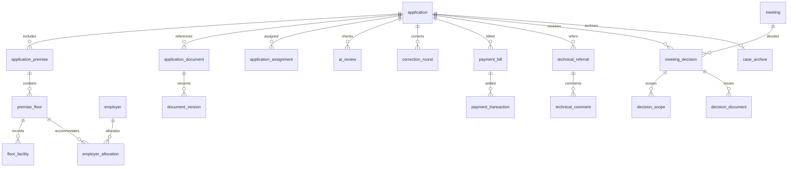

# Pelan skema dan peraturan Fasa 2

Modul berikut belum mempunyai pelaksanaan keputusan atau data permohonan rekaan. Kontrak integrasi disediakan tetapi tidak diaktifkan.

## Model hubungan yang dicadangkan

`application`: UUID dalaman sejak penghantaran pertama; `official_reference` nullable hingga lengkap disahkan PIC, version/status dan tarikh. `company_id`/representative snapshot mengekalkan kapasiti semasa penghantaran.

`application_premise`: lot, alamat, koordinat, kawasan, unit. `premise_floor`: nombor tingkat, bilik, pekerja, keluasan. `floor_facility` dan `employer_allocation` merekod kapasiti serta kemudahan mengikut unit/aras. Sumber tunggal menjana jadual konsolidasi.

`application_document`: pautan kepada dokumen umum atau premis/aras, termasuk `delegation_document_id` Fasa 1 yang masih sah. `document_version`: object key, checksum, tarikh versi dan asal. Geran/hak milik mesti terkini dalam enam bulan. Dokumen dan surat kuasa yang relevan boleh dipautkan semula tanpa kehilangan versi.

`application_assignment`: skop kes/unit, PIC, sebab dan pihak PPSK. Premis berbilang lokasi boleh memerlukan aturan PIC khusus; jika tidak jelas, `PERLU PENENTUAN PPSK`.

`ai_review`: input version IDs, model/version, dapatan, masa, human confirmation. AI Pre-Check membantu PIC dan tidak meluluskan sendiri. `correction_round` mengekalkan UUID yang sama.

## Gerbang proses wajib

1. Penghantaran awal: UUID unik sahaja. **Jangan jana rujukan `MBSP/...` di sini.**
2. PIC mengesahkan lengkap: jana rujukan rasmi unik dalam transaksi, boleh diaudit.
3. Bil RM50 **setiap unit premis**, bukan setiap tingkat. Webhook MBSPPay mesti disahkan secara kriptografi, idempotent dan dipadankan dengan bil/jumlah.
4. Selepas pengesahan bayaran sebenar, rujuk Perancang Bandar dan Kejuruteraan secara automatik dan serentak. Tempoh ulasan tujuh hari kalendar; tiada ulasan bukan persetujuan.
5. Ulasan umum serta mengikut unit/aras. Kedua-dua jabatan hanya melihat data kes yang dirujuk dalam skop kuasa.
6. KP-PPTT menggunakan templat berpusat dan data konsolidasi. PIC boleh menyemak/meminda; boleh disediakan sebelum tujuh hari dengan status ulasan yang tepat.
7. `meeting_decision` menyimpan LULUS, LULUS_BERSYARAT, TOLAK atau TANGGUH. `decision_scope` boleh berbeza setiap unit/aras, bilik dan kapasiti.
8. Satu surat keputusan induk dengan jadual terperinci. Keputusan susulan menggunakan rujukan induk sama, sambil mengekalkan sejarah keputusan.
9. Tandatangan elektronik/digital dan PDF terlindung hanya selepas integrasi dan hierarki pengesahan diluluskan. Penyedia tidak boleh mengesahkan sendiri walaupun bertukar peranan.
10. Penutupan kes induk automatik hanya apabila semua skop diputuskan muktamad dan semua dokumen keputusan dikeluarkan; audit dan arkib digital kekal.

## Urutan pembangunan dicadangkan

Muktamadkan peraturan kawasan dan UAT Fasa 1 → modul permohonan/premis/aras/dokumen → workflow PIC/pembetulan → rujukan rasmi dan MBSPPay → teknikal selari/SLA → KP-PPTT/mesyuarat → keputusan berskop/tandatangan → arkib dan laporan. Setiap langkah memerlukan migrasi, ujian negatif kuasa/skop dan ujian integrasi sebenar apabila akses tersedia.
