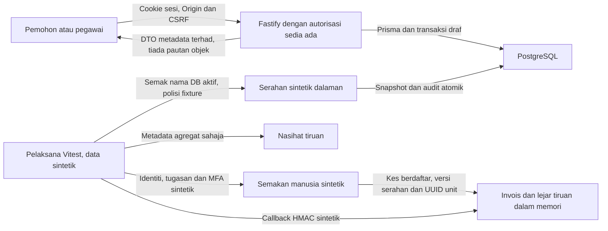

# Serahan ICT STAYLink MBSP Fasa 1

Sambungan Issue #31 tersedia dalam [portal integrasi sintetik](SYNTHETIC-PORTAL.md).

Issue #36 merangkumi [pemantapan UAT dan keselamatan](UAT-SECURITY.md) serta [skrip fasilitator](DEMO.md).

Issue #40 menyediakan [penerimaan teknikal pra-staging dan laporan keselamatan](PRESTAGING-ASSURANCE.md).

Issue #45 merekodkan [cadangan dasar dan keputusan pemilik proses](OWNER-PROPOSALS.md).

Issue #49 menyediakan [cockpit UAT dalaman dan skrip demonstrasi](INTERNAL-UAT-COCKPIT.md).

Issue #54 menyediakan [panduan fasilitator dan triage](UAT-FEEDBACK-TRIAGE.md) serta [pakej keputusan pemilik dan gerbang keluaran](OWNER-DECISION-PACK.md).

Issue #58 menyediakan [panduan pelaksanaan berpandu](GUIDED-INTERNAL-UAT.md) dan [pakej penerimaan serta keputusan pemilik](GUIDED-UAT-ACCEPTANCE.md).

Issue #62 menyediakan [templat hos dan kesediaan Demo Release 1.0](DEMO-RELEASE-1-JTIK-HANDOVER.md).

Pakej Issue #24 merangkumi pelaksanaan awal dan pengesahan sintetik. Kelulusan operasi, UAT MBSP dan kebenaran keluaran mempunyai rekod berasingan. Jejaki peringkat pembangunan dalam [pelan berkelompok](../STAYLINK-PHASE1-MULTIWORKSTREAM-ICT-HANDOVER.md), [pelan K02](../K02-UNIT-IDENTITY-PLAN.md) dan [spesifikasi K03/K04/K07](../K03-K04-K07-DOCUMENT-SECURITY-SPEC.md).

## Aliran data dan sempadan kepercayaan

Metadata draf dan dokumen berada dalam PostgreSQL. Audit serahan sintetik menyimpan ID pelaku, tindakan, sasaran dan versi. Snapshot menyimpan kapasiti, rujukan kuasa, inventori fizikal dan metadata bukti berversi. DTO dokumen menyembunyikan kunci storan dan hash. Ujian kuarantin menggunakan fail atau verdict sintetik. Laluan upload dan submit rasmi kekal ditutup. Inventori pegawai, AI dan bayaran bagi gelombang C/D ialah fungsi dalaman yang dipanggil oleh ujian.

## Inventori semakan dan kebergantungan

| Gelombang | Head | Kontrak yang boleh disemak | Jurang pelaksanaan |
| --- | --- | --- | --- |
| A · K03/K04/K07 | `issue-24-policy-authority` | `GET /api/application-drafts/:id/documents` memulangkan `scope` atau `null` selepas semak pemilikan dan kuasa. Polisi dokumen dalaman menyemak syarat, kategori alternatif, skop, scan dan verifikasi. | Satu skop untuk setiap versi dokumen. Aliran mengurus pautan, bukti kuasa berdiri sendiri, tamat tempoh bukti dan pilihan storan menunggu kontrak MBSP. |
| B · K05/K06 | `issue-24-sandbox-submission` | `captureSyntheticSubmission` memerlukan konfigurasi fixture, versi, persetujuan eksplisit dan kunci idempotensi. Snapshot dan audit ditulis dalam satu transaksi PostgreSQL. | Pembetulan diluluskan oleh fixture untuk serahan terdahulu. Aliran kerja pegawai, UI akuan, notifikasi dan polisi rasmi menunggu pengesahan. |
| C · K08/K10 | `issue-24-review-sandbox` | `mockPrecheck` hanya nasihat berdasarkan tiga kiraan. Semakan manusia sintetik memerlukan tugasan, kawasan, hak semakan, MFA, versi, alasan dan pelaku berasingan daripada pemula. | Tugasan PIC, keputusan dan audit belum dipersistensikan. Rujukan dengan awalan `SYNTHETIC-` hanya hasil fixture. |
| D · K09 | `issue-24-billing-sandbox` | Invois MYR berdasar UUID unit unik dan serahan yang didaftarkan dalam fixture. Callback tiruan disahkan HMAC dan dipadankan dengan jumlah, mata wang dan invois. | Lejar dalam memori. Penguncian DB, kontrak callback penyedia, pengasingan akaun, pembatalan dan settlement sebenar memerlukan spesifikasi dan kelulusan Kewangan/ICT. |
| E · ICT | `issue-24-ict-handover` | Inventori, sempadan, kawalan, matriks penerimaan dan SOP. | UAT, semakan keselamatan staging dan bukti kelulusan operasi. |

Tertib cabang ialah A → B → C → D → E. Asas A ialah `issue-24-phase1-multiworkstream` daripada [PR #25](https://github.com/BangunanDotCom/sipintar-mbsp/pull/25). Rujukan pra-syarat ialah [PR #19](https://github.com/BangunanDotCom/sipintar-mbsp/pull/19), [PR #21](https://github.com/BangunanDotCom/sipintar-mbsp/pull/21) dan [PR #23](https://github.com/BangunanDotCom/sipintar-mbsp/pull/23).

## Skema dan pemulihan

- `application_drafts → application_premises → premise_units`; `premise_unit_floors` memaut unit dan tingkat dalam draf yang sama.
- `application_documents → draft_document_scopes` mempunyai FK komposit kepada dokumen dan unit atau tingkat. Tiada kerja backfill. Rekod lama kekal boleh dibaca. Pembuangan unit atau tingkat yang mempunyai bukti dipautkan menerima konflik.
- `application_drafts → synthetic_submissions` unik bagi versi dan kunci ulang per draf. FK komposit mengekalkan pembetulan dalam draf asal. Pencetus menyekat `UPDATE` dan `DELETE` pada serahan; akses DDL dan salinan sandaran perlu diurus oleh DBA. Migrasi menambah jadual dan indeks tanpa menulis semula rekod domain sedia ada.
- Sebelum sebarang rintis, DBA merekod ukuran kunci, masa pemulihan dan ujian deployment aplikasi versi terdahulu dengan skema tambahan. Pelan undur aplikasi mendahului pertimbangan undur skema. Kekalkan jadual dan rekod audit sementara menilai insiden. Pemulihan data, termasuk penyelarasan storan objek pada masa yang sama, memerlukan latihan staging yang diluluskan.

## Matriks keputusan dan penerimaan

| Perkara | Asas reka bentuk yang direkod | Diperlukan daripada pemilik | Gelagat sementara |
| --- | --- | --- | --- |
| K03 dan K04 | Identiti pemohon berasingan daripada pelaku. Bukti mesti sepadan dengan kapasiti dan skop. | Jabatan Bangunan mengesahkan bukti kuasa yang diterima, kesahan, pengganti, kategori wajib, pengecualian dan siapa boleh mengesahkan. | Polisi versi hanya dalam fixture. |
| K05 dan K06 | Akuan versi dan masa pelayan, semakan sebelum serahan serta sejarah versi pembetulan. | Jabatan Bangunan, ICT dan penasihat undang-undang meluluskan teks akuan, medan wajib, tempoh pembetulan dan aturan perubahan kapasiti. | Endpoint serahan rasmi menyekat tindakan. |
| K07 | Kuarantin dan scan gagal tertutup, akses berdasarkan autorisasi semasa. | ICT memilih penyedia dan rantau, had fail, pengurusan kunci, mutu pengimbas dan pengawasan. Unit Rekod menentukan tempoh simpan, legal hold dan pelupusan sandaran. | Storan, upload dan muat turun operasi draf dinyahaktifkan. |
| K08 dan K10 | AI hanya nasihat, semakan manusia sebelum daftar dan audit. | Jabatan Bangunan/ICT sahkan matriks PIC/PPSK/Penyelia, skop, pemisahan tugas, proses rayuan, siri rujukan dan kelayakan data AI. | Tiada permission pegawai baharu. Rujukan dan keputusan hanya sintetik. |
| K09 | Asas RM50 setiap unit fizikal unik selepas semakan dan pendaftaran. | Kewangan/ICT sahkan kontrak sandbox, lejar, tempoh invois, callback, refund dan proses penutupan penyelarasan. | Tiada provider client, URL bayaran atau callback HTTP baharu. |
| UAT dan keluaran | Bukti ujian, pengesah bernama, versi polisi dan SOP diperlukan. | ICT/pemilik sistem meluluskan RPO/RTO, UAT, risiko tersisa dan keluaran semasa. | Gerbang operasi kekal tertutup. |

Catat ID keputusan, pilihan, pelulus, tarikh berkuat kuasa, versi polisi dan pautan minit sebelum mengubah gerbang.

## SOP ringkas

- **Pemohon** menyimpan draf, meneliti identiti dan unit, dan menyemak metadata dokumen. Sistem hanya memaparkan status yang disokong oleh operasi sebenar.
- **Pegawai** mengesahkan identiti dan skop sebelum akses. Gunakan MFA dan jejak audit. Bukti imbasan dan keputusan manusia mempunyai maksud berasingan.
- **ICT** gunakan Node 22 dan Prisma yang dijana daripada checkout. Jalankan integrasi pada PostgreSQL loopback sintetik dengan `DATABASE_URL` dan `TEST_DATABASE_URL` sama, dan Mailpit tempatan. Tetapkan `STAYLINK_DOCUMENT_STORE=disabled`, `STAYLINK_LOCAL_DOCUMENT_STORE_ENABLED=false` dan `STAYLINK_CLAMAV_ENABLED=false` untuk suite ini. Simpan rahsia dalam konfigurasi setempat dengan akses terkawal.
- **Insiden** tutup gerbang berkenaan, hadkan akses, simpan bukti dan audit pengendali tanpa merekod kandungan dokumen. Escalasi kepada ICT, Unit Rekod dan Jabatan Bangunan mengikut klasifikasi. Selepas pengesahan bebas, buka semula mengikut keputusan pemilik yang direkod.
- **Persekitaran** sintetik untuk pembangunan dan pemulihan, staging berasingan selepas kelulusan ICT, produksi hanya selepas penilaian operasi lengkap. Dalam staging, sahkan kawalan DB dan storan, putaran kunci, masa pemulihan, scanner sebenarnya, pergerakan callback dan pemetaan peranan.

Rujuk [laporan pengesahan](VERIFICATION.md) sebelum semakan teknikal.
