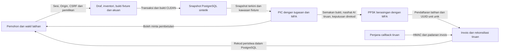

# Portal integrasi sintetik STAYLink MBSP · Issue #31

Pendahuluan kepada penilaian staging. Gunakan data latihan sahaja. Gerbang portal operasi, storan dokumen, AI pihak ketiga, pembayaran dan nombor rasmi kekal tertutup. Rujuk [pakej serahan Fasa 1](README.md) dan [bukti Issue #24](VERIFICATION.md).

## Aliran dan sempadan

Serahan mengambil inventori K01/K02 daripada draf tersimpan, menyemak kapasiti dan kuasa wakil K03, polisi bukti per tingkat K04/K07 serta akuan K05 dan pembetulan K06. Pengesahan kesiapsiagaan menggunakan aturan premis dan tingkat yang sedia ada. Keputusan PIC dan pendaftaran PPSK meliputi K08/K10. K09 menggunakan sen dan UUID fizikal unik daripada snapshot berdaftar. Pembetulan mengekalkan pemohon dan kapasiti awal serta mewujudkan snapshot sambungan. Gerbang rasmi kekal ditutup.

Draf, unit, tingkat, metadata dan snapshot menggunakan jadual sedia ada. Keputusan dan invois latihan disimpan sebagai acara `SYNTHETIC_PORTAL_*` dalam `audit_logs` menggunakan kunci baris serahan bagi tindakan bersaing. Callback replay yang sepadan memulangkan hasil sedia ada. Ledger operasi memerlukan model berasingan, constraint transaksi, penjagaan rekod dan rekonsiliasi kewangan. Tiada migrasi skema baharu dalam Issue #31.

## Inventori API

Awalan semua laluan percubaan ialah `/api/synthetic-portal`. Respons menggunakan `Cache-Control: private, no-store`. Laluan draf rasmi kekal seperti sedia ada.

| Laluan | Pemanggil dan hasil |
| --- | --- |
| `GET /drafts/:id` | Pemilik draf dengan kuasa semasa. Mengembalikan versi, akuan, senarai bukti latihan, kesiapsiagaan, resit, status dan alasan pembetulan. |
| `POST /drafts/:id/evidence` | Pemilik draf. Menjana metadata sahaja berdasarkan verdict tiruan, separa proses pembetulan. Memerlukan versi draf. Tiada penerimaan bait muat naik atau pautan muat turun. |
| `POST /drafts/:id/submit` | Pemilik yang menerima versi akuan. Memerlukan versi draf, kunci ulang UUID dan rujukan serahan terdahulu jika pembetulan. |
| `GET /reviews` | PIC atau PPSK yang dilantik dalam konfigurasi fixture dan mempunyai hak `areas.read`, tugasan daerah aktif serta MFA. Pulangkan sehingga 50 serahan terkini daerah, bersama ringkasan bukti dan nasihat tiruan. |
| `POST /reviews/:id` | PIC boleh meminta pembetulan atau mengesahkan kelengkapan. PPSK lain mendaftar selepas kelengkapan. Memerlukan versi, alasan dan serahan yang masih semasa. |
| `GET /drafts/:id/billing` | Pemilik yang masih layak. Paparkan ringkasan status invois latihan. |
| `GET /reviews/:id/billing`, `POST /reviews/:id/billing` | Pegawai ditugaskan boleh membaca. PPSK boleh menjana invois dan mensimulasikan callback hanya selepas pendaftaran latihan. |
| `POST /callbacks/payment/:id` | Pengirim tiruan. Terima `{payload}` yang ditandatangani HMAC-SHA256 dalam `x-staylink-synthetic-signature`. Semak tandatangan sebelum akses DB, kemudian ikat amaun, mata wang, tempoh dan rujukan kepada invois latihan. |

Bukti disaring mengikut draf dan versi. Tiada kunci objek dalam DTO portal latihan. Nasihat AI berasal daripada kiraan agregat dan tiada penghantaran data luar. Pemberian akses sedia ada tidak berubah. ID PIC/PPSK tetapan ialah pelantikan bagi daerah latihan. Dasar peruntukan tepat per kes belum diluluskan.

## Konfigurasi, pemulihan dan UAT

- Gunakan `STAYLINK_SYNTHETIC_PORTAL=true` hanya dengan `NODE_ENV=test` atau `development` dan URL PostgreSQL yang sama untuk `DATABASE_URL` serta `TEST_DATABASE_URL`. Kedua-duanya mesti menggunakan `127.0.0.1:5432` dan nama DB `staylink_issue31_<label>_test`. API menyemak nama sambungan PostgreSQL aktif sebelum mendaftar laluan. Tanpa opt-in yang sah, laluan tidak tersedia.
- Untuk menguji kerja pegawai, tetapkan tiga pemboleh ubah `STAYLINK_SYNTHETIC_DISTRICT`, `STAYLINK_SYNTHETIC_PIC_ID` dan `STAYLINK_SYNTHETIC_SUPERVISOR_ID`. Kedua-dua pegawai mesti berbeza, mempunyai peranan dan pelantikan kawasan aktif. Untuk billing, jana `STAYLINK_SYNTHETIC_CALLBACK_KEY` daripada 32 bait rawak dan simpan di luar repositori.
- Jalankan migrasi sedia ada menggunakan `npm run db:test:migrate` pada DB latihan tersebut. Asingkan pangkalan data Vitest, Playwright dan pemulihan. Set `STAYLINK_DOCUMENT_STORE=disabled`, `STAYLINK_LOCAL_DOCUMENT_STORE_ENABLED=false` dan `STAYLINK_CLAMAV_ENABLED=false`. Gunakan Mailpit loopback. Sandarkan hanya DB sintetik dalam format `pg_dump -Fc` dan sahkan hasil `pg_restore --exit-on-error` sebelum menggunakan kandungan untuk semakan.
- UAT pemohon. Simpan premis, dua tingkat dan satu unit yang merentasi kedua-duanya. Jana verdict FAILED dan sahkan butang serahan disekat. Jana bukti CLEAN, baca dan sahkan akuan, lalu simpan resit. Selepas PIC menghantar balik, semak alasan, simpan pembetulan dan sahkan akuan versi semasa.
- UAT pegawai. PIC memeriksa unit, bukti dan nasihat tiruan, merekodkan alasan dan mengesahkan kelengkapan. PPSK yang berlainan mendaftar, menjana invois untuk satu unit pada RM50 dan merekod rekonsiliasi tiruan. Pemohon membuka semula portal untuk menyemak ringkasan.
- `tests/api.test.ts` mengandungi dua kes Issue #31 yang hanya dijalankan apabila opt-in dan nama DB latihan sepadan. `tests/e2e/synthetic-portal.spec.ts` memerlukan pemboleh ubah latihan dan memprovisikan identiti serta sesi pemohon/pegawai sintetik. Suite portal sedia ada turut memeriksa log masuk dan pendaftaran MFA melalui UI.

| Pemilik keputusan | Perkara yang belum dibuka |
| --- | --- |
| Jabatan Bangunan | Bukti dan teks akuan rasmi, had pembetulan, tugasan PIC per kes, delegasi penyelia, aturan rayuan, nombor rasmi dan keputusan muktamad. |
| ICT dan Unit Rekod | Penyedia storan, imbasan sebenar, bukti pengasingan staging, retensi, legal hold, keperluan audit yang tidak boleh diubah dan kelulusan keselamatan. |
| Kewangan bersama ICT | Takrif unit bercaj, kontrak sandbox, lejar kewangan rasmi, cara rekonsiliasi dan pembatalan, pengurusan kunci dan semakan operasi. |

Mengemas kini keputusan memerlukan pengecam dasar, pelulus, tarikh kuat kuasa, versi konfigurasi dan pautan SOP. Latihan ini membuktikan kelakuan aplikasi dengan data dan jawapan tiruan sebelum ujian penerimaan MBSP.

## Bukti pengesahan · 19 November 2026 (MYT)

| Pemeriksaan | Hasil |
| --- | --- |
| Pemasangan dan analisis kod | `npm ci`, `npm run db:generate`, TypeScript, lint dan binaan lulus. Binaan masih mengeluarkan amaran saiz chunk dan komen anotasi Rollup daripada kebergantungan. |
| Vitest | 284 ujian lulus dalam 43 fail di luar integrasi API. |
| PostgreSQL dan API | 74 lulus pada DB Issue #31. Satu kes legacy Issue #24 dilangkau dalam suite itu dan lulus apabila dijalankan berasingan pada DB yang sesuai. Termasuk pemilikan, Origin/CSRF, MFA, kuasa ditarik selepas pertukaran kapasiti draf, versi lapuk, verdict dan bukti gagal serta pemulihan kepada CLEAN, pemeliharaan snapshot, idempotensi serentak, amaun callback dan ulangan. |
| Audit npm | 0 advisori pada masa audit. Pengimbas, AI dan bayaran sebenar masih di luar skop latihan. |
| Pulih salinan sintetik | Migrasi sedia ada boleh dijalankan semula pada dua DB latihan baharu. `pg_dump` dan `pg_restore` berjaya pada satu salinan kosong. Sampel asal dan salinan mempunyai 8 serahan, 3 peristiwa lengkap, 3 invois, 3 rekonsiliasi dan pencetus perlindungan snapshot aktif. |
| Playwright | Suite penuh lulus 27 pada `63c330a`. Kes portal Issue #31 dijalankan semula pada `cd889c6` dan lulus selepas pengetatan semakan kuasa wakil. Chromium dan API menggunakan port loopback berasingan dalam salinan ujian. Kegagalan 429 awal dibetulkan melalui refetch yang disasarkan dan penjadualan ujian mengikut had permintaan sedia ada. |
